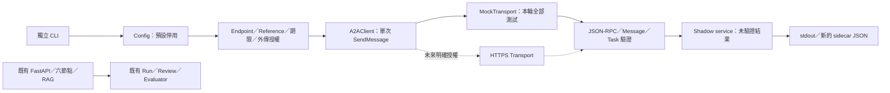

# A2A Client MVP：獨立 Shadow Integration

> 2026-10-28 更新：本文保留首版實作與測試歷史。現行 Client 已依研究者指示移除 EgressGrant／Operator／Approval／到期審批，並新增公開 Card GET、文字問句與 GetTask。本文舊版 Grant、enabled 環境變數與 Live CLI 命令不再適用；目前操作請見 [A2A_MINIMAL_CLIENT.md](A2A_MINIMAL_CLIENT.md)。這不影響原有 OpenAI 六 Agent 的單次付費 Run 保護。

日期：2026-10-27。基準 Git commit：`1ad2648a349c28989c9fa3d41cd37bf56a40f0fd`。本次沒有 commit。

已完成可執行的獨立 Client、CLI 與離線測試。**沒有連線工研院、取得 Agent Card、使用真實 Token 或執行醫療推論。** 工研院部署的實際協定相容性仍未驗收。Mock 是合成傳輸回覆，不能當 Clinical Gold。

## 1. 架構與新增檔案



沒有 Shadow → Workflow 或 Gold 的資料路徑。

| 新增檔案 | 職責 |
| --- | --- |
| `backend/app/integrations/__init__.py` | 獨立 integrations package；無啟動副作用 |
| `backend/app/integrations/a2a/__init__.py` | A2A package；import 不作 I/O |
| `backend/app/integrations/a2a/config.py` | runtime 環境設定、HTTPS／版本／憑證／大小／timeout 驗證 |
| `backend/app/integrations/a2a/contracts.py` | request builder、嚴格 JSON parser、Message／Task 子集、固定安全錯誤、Secret Redaction |
| `backend/app/integrations/a2a/client.py` | EgressGrant、SendMessage、可注入 transport、拒絕 redirect、不重試、未支援能力的明確拒絕介面 |
| `backend/app/integrations/a2a/service.py` | `analyze_reference` 建立獨立、未經臨床驗證的 result envelope |
| `backend/scripts/probe_itri_a2a.py` | 預設 Mock CLI、顯式 Live gate、授權檔讀取與 exclusive-create 匯出 |
| `backend/tests/integrations/a2a/test_client.py` | 65 項離線測試；所有 fixture 都是 synthetic |
| `docs/A2A_CLIENT_MVP.md` | 本文件 |

沒有修改既有檔案、lockfile、API router、Provider registry、六角色、Prompt、RAG、Evaluation 或病例設定。沿用 `.venv` 中的 httpx 0.28.1，未安裝新套件。驗證輸出另置 `data/runtime/a2a-mvp-20261027/`，不是正式病例或 Gold。

## 2. 支援的契約與限制

- 唯一已實作 profile：`a2a-1.0-jsonrpc`。這是**本機 parser 的協定子集名稱**，不是對工研院合規程度的宣告。
- POST JSON-RPC `2.0`，method `SendMessage`；產生不同的 UUID `id` 與 `messageId`，role `ROLE_USER`、單一 text part。
- 只接受 1–80 字元英數、底線、連字號的單一 reference；不接受病例 dict、Run JSON、文件或任意 prompt。此限制不能證明 reference 是合成資料，仍需人工核准。
- 回覆須為 JSON-RPC 2.0、相同 id，`result`／`error` 恰有一個。`result.message`／`result.task` 亦恰有一個。
- Message 驗證 messageId、role、parts；頂層回覆 role 須為 ROLE_AGENT。支援 text／object data parts。Task 驗證 id、列舉 state、可選 history、status.message、artifacts 的基本結構。
- 保留全部八種已知 Task state；`TASK_STATE_WORKING` 不等於完成；`TASK_STATE_COMPLETED` 也不等於臨床內容正確。
- 任意附加 metadata/data 仍是不可信資料；不是完整官方 Schema validation 或抗生素分析 Schema。
- 拒絕未知 protocol/profile、錯誤 envelope、重複 JSON key、NaN、無效 JSON、未知 task state、file/url/raw parts。沒有 0.3 fallback 或猜測修復。
- 不支援 Card discovery、GetTask polling、CancelTask、Streaming/SSE、push notifications、多輪續問、檔案下載及完整 A2A SDK。`get_agent_card`、`get_task`、`stream_message` 明確拋出 `*_NOT_IMPLEMENTED`，不發送網路請求。

回覆有引用／URL／程式文字也不會被執行或自動抓取。未建立臨床欄位 mapper；外部資料不能直接作 Synthesis、Audit 或 Gold。

## 3. 設定、安全 gate 與錯誤

Client 預設 `enabled=False`；沒有任何 startup hook。Mock CLI 使用內建 `https://a2a.invalid/a2a` 與動態 synthetic credential、MockTransport，完全忽略 Live 環境變數。

| 環境變數 | 預設／規則 |
| --- | --- |
| `ITRI_A2A_ENABLED` | false；只接受 true/false |
| `ITRI_A2A_ENDPOINT` | 空；需明確 HTTPS URL，不允許 userinfo、query、fragment、空白或 credential 出現在 URL |
| `ITRI_A2A_PROTOCOL_PROFILE` | 空；須明確設定 `a2a-1.0-jsonrpc` |
| `ITRI_A2A_PROTOCOL_VERSION` | `1.0`；其他版本拒絕，不能僅修改版本文字就套用同一 parser |
| `ITRI_A2A_VERSION_HEADER` | `A2A-Version`；空字串代表顯式不送 header，僅限對方確認需要此差異時使用；其他 header 名拒絕 |
| `ITRI_A2A_API_KEY` | 空；僅 runtime 注入，不使用 LLM_API_KEY、不讀 `.env`、不放 CLI argument |
| `ITRI_A2A_CONNECT_TIMEOUT_SECONDS` | 5 秒 |
| `ITRI_A2A_READ_TIMEOUT_SECONDS` | 30 秒 |
| `ITRI_A2A_TOTAL_DEADLINE_SECONDS` | 45 秒；在讀取 chunk／完成解析後檢查時間預算 |
| `ITRI_A2A_MAX_RESPONSE_BYTES` | 1 MiB；設定上限 10 MiB |

**Timeout 邊界**：httpx timeout 限制各次 I/O 等待；deadline 是同步串流檢查的 elapsed budget，不是能立即中斷 DNS／底層阻塞的嚴格 wall-clock watchdog。單次阻塞可能使實際返回晚於 deadline。Timeout 不表示遠端工作取消或沒有計費。將來若要求硬性 SLA，需另外設計可取消的執行與遠端取消契約。

每次 Client 呼叫另需 `EgressGrant`：完整 endpoint、精確 reference、operator、purpose、approval_record、具時區且尚未到期的 expires_at，以及固定 `scope=synthetic-reference`。缺少／不符即在建立 HTTP Client 前拒絕。**不依賴病例的 external_model_allowed。**

Grant 是受信任本機操作者提供的授權聲明，不是簽章、IAM 或機構審核系統；程式無法自行核實 approval_record 是否真實或測試代碼是否觸及遠端真實病例。若未來提供多人／網頁 API，必須加入伺服器端認證與可驗證的授權紀錄，不能直接接受前端自填 Grant。

HTTP Client 不跟隨 redirect、不使用環境 proxy／netrc、不自動重試；一次呼叫最多一個 POST。401/403/429/5xx 和 redirect 回 `HTTP_ERROR`；JSON-RPC error 僅保留數字 code。Timeout、connection、格式錯誤皆有本地固定代碼，不輸出遠端錯誤 body。網路錯誤標示 `delivery_unknown=true`，禁止據此推定可以安全重送。

沒有 request/body 日誌。httpx/httpcore 在本次同步呼叫執行緒的 transport logs 被暫時過濾，避免 DEBUG response header 回顯 credential；結束後移除 filter，不改 logger level、不抑制其他執行緒。回傳 payload 遞迴遮蔽本次精確 Token、Bearer 字串與敏感 key；config repr 隱藏 endpoint/credential，例外不顯示第三方錯誤全文。這不等於病歷去識別，也不能保證識別遠端刻意編碼／變形的所有秘密；不可把 sidecar 任意公開。

## 4. Mock CLI 操作

在 Repository 根目錄以 PowerShell 執行，無需開服務、API Key、Ollama 或 GPU：

```powershell
Set-Location backend
./.venv/Scripts/python.exe -B -m scripts.probe_itri_a2a
./.venv/Scripts/python.exe -B -m scripts.probe_itri_a2a --mock-response task
# 父目錄需已存在；檔名必須尚未存在。
./.venv/Scripts/python.exe -B -m scripts.probe_itri_a2a --out ../data/runtime/my-new-a2a-shadow.json
```

預設 reference 是 `SYNTHETIC_DEMO_001`，不是工研院病例碼。Message fixture 只回「Synthetic transport fixture; no medical inference.」；Task fixture 只回 WORKING，不自動輪詢。即使環境中設定了真實 endpoint/key，未加 `--live` 仍只會走 MockTransport。

CLI 成功回傳 exit 0（表示協定解析成功，不代表 Task 成功或完成）；gate／transport／檔案錯誤 exit 2。`--out` 以 `x` 模式先保留新檔案，檔案已存在則在傳送前拒絕；失敗可留下安全錯誤 JSON 或空檔，不能將檔案存在當成功。

本輪實際保存的 `mock-message.json` 與 `mock-task.json` 均包含：

```json
{
  "schema_version": "a2a-shadow-0.1",
  "untrusted": true,
  "clinical_decision_eligible": false,
  "gold_eligible": false,
  "application_validation": "not_evaluated",
  "transport_mode": "mock",
  "protocol_profile": "a2a-1.0-jsonrpc",
  "usage": null,
  "estimated_cost": null
}
```

以上是實際 envelope 的共同欄位節錄；完整檔案另有 UUID、elapsed_ms、response_bytes、attempts=1、payload 與 endpoint hash。Token usage/cost 未知保留 null，沒有虛構模型或六節點執行紀錄。Endpoint hash 只供比對，不代表匿名化。Sidecar 不是現有 Run 格式，不可直接交給 Offline Evaluator 當既有六節點 Run。

## 5. 驗證結果與重現

環境：Windows、專案 `.venv` Python 3.12.14、httpx 0.28.1、pytest 8.4.2。沒有新增全域安裝或改 PATH。

| 驗證 | 結果 |
| --- | --- |
| A2A tests 最終執行 | **65 passed，0 failed／errors／skipped** |
| Backend 全部 Regression（含 A2A、Evaluation、Pilot draft、六節點與既有 API tests） | **549 passed，0 failed／errors／skipped；19.77 秒** |
| 原有 suite 子集合 | 484 項；549 已包含新增的 65 項，兩個數字不可相加 |
| Mock CLI Message／Task | 兩次成功，獨立新 sidecar；無外部連線 |
| 保存檔案 hash 對照 | **1,704 個既有受保護檔案全部相同** |

A2A 測試實際指令（cwd=backend）：

```powershell
./.venv/Scripts/python.exe -B -m pytest tests/integrations/a2a -q --tb=short --basetemp ../data/runtime/a2a-mvp-20261027/unit-temp-final --junitxml ../data/runtime/a2a-mvp-20261027/unit-final.xml
```

重新執行請更換 `--basetemp`／XML 檔名，保留本輪證據。

Regression 實際執行（cwd=Repository）：

```powershell
& data/runtime/a2a-mvp-20261027/Run-Regression.ps1 -Label normal-user
```

該隔離 runner 設定 LLM_PROVIDER=mock、RAG_RETRIEVAL_MODE=lexical、A2A disabled，移除子程序的真實模型/A2A key，將 DB、pytest temp 與 logs 導向本輪 runtime 目錄。實際 pytest 為 `python -X utf8 -B -m pytest -p offline_guard tests -q --tb=short`，再附 runner 的新 basetemp/XML 路徑。不要在既有日常服務環境下無隔離地直接 import app.main 來重跑。

`offline_guard.py` 封鎖 DNS 與 socket connect/connect_ex；只允許 Windows 標準函式 socketpair 內部的 loopback 配對，供 TestClient 事件迴圈使用。A2A unit tests 額外直接封鎖 socket/DNS。所有 API tests 都在隔離資料庫，沒有啟動或中斷日常前後端。

本輪排障紀錄：第一版 guard 連標準 socketpair 都封鎖，造成 **503 passed、25 failed、21 errors**；錯誤堆疊確認來自 TestClient 初始化，未更改產品程式來修補測試。限縮放行後，sandbox 執行停在 Windows loopback；僅停止本輪匹配 `pytest-guarded` 的程序，以一般使用者權限重新執行同一組帶外網封鎖的 tests，得到上述 549 passed。仍有 4 個既有 Starlette/httpx/AnyIO/FastAPI 棄用警告。

驗證證據（runtime artifacts，未提交 Git）：

- `data/runtime/a2a-mvp-20261027/unit-final.xml`
- `data/runtime/a2a-mvp-20261027/regression-normal-user.xml`、同名 `.log`
- `data/runtime/a2a-mvp-20261027/regression-first.xml`、同名 `.log`（保留最初 guard 失敗）
- `data/runtime/a2a-mvp-20261027/Run-Regression.ps1`、`offline_guard.py`
- `data/runtime/a2a-mvp-20261027/mock-message.json`、`mock-task.json`
- `data/runtime/a2a-mvp-20261027/before.json`、`preservation.json`

Hash 範圍含既有 backend/app、backend/tests、docs、handoff、Pilot evaluation 資料與 `data/runtime/mock-check`（排除工具安裝／node_modules／pycache）。日常 DB、Run、Review、RAG index 檔案位元組未變；既有原始程式及文件亦未變。Git 原先三個修改過的測試檔仍是先前工作，這輪未再修改。

## 6. 未來第一次 Live Connection Test（本輪未執行）

1. 取得離線 Agent Card／完整成功與錯誤範例，確認是本 Client 的 profile，或另開任務實作明確 custom profile。不能為了通過而忽略 parser 錯誤。
2. 向對方確認合成測試 reference、費用、讀取遠端資料範圍、資料保存及有效新 Token。`INF000044` 尚未被本實作認定為安全測試資料。
3. 由授權研究者核准一次操作，建立本地 Grant 檔。這份檔案不是 Token 檔，不能把 credential 寫入其中。以下只是**待填模板，不是真實授權**：

```json
{
  "endpoint": "<與已核准設定完全相同的 HTTPS endpoint>",
  "reference": "<對方核准的合成測試 reference>",
  "operator": "<操作人員識別>",
  "purpose": "<核准的協定 smoke test 用途>",
  "approval_record": "<可供人工查核的授權紀錄 ID>",
  "expires_at": "<具時區的 ISO 8601 到期時間>",
  "scope": "synthetic-reference"
}
```

4. 僅在該次操作程序設定 enabled、endpoint、profile/version/header 與必要 timeout；由安全的 credential provisioning 流程注入 `ITRI_A2A_API_KEY`。不要把 Token 貼進命令、版本控制、文件或螢幕輸出。首次不要使用含任意病歷自由文字的 reference。
5. 在 backend 執行以下 **未來命令模板**，所有值必須先完成上述核實；不要現在執行：

```powershell
./.venv/Scripts/python.exe -B -m scripts.probe_itri_a2a --live --authorize-egress --grant-file <本地核准檔路徑> --reference <核准reference> --out <全新sidecar路徑>
```

只有 `--live` 不足；還需 enabled=true、完整有效 config、`--authorize-egress` 與匹配且未過期的 Grant。呼叫僅發送 reference，不讀日常病例／RAG／Run。回 Task 就記錄 state，不再送另一個 SendMessage；逾時後先與對方確認遠端工作與費用，不直接重試。完成後由 credential 管理流程清除當次 runtime secret／停用旗標。

通過此步只代表 transport/profile smoke pass；醫療輸出仍須另外取得應用 Schema、來源對齊與獨立 Gold。

## 7. 接入六節點或研究比較前的待確認事項

- 工研院真正支援的協定版本、header、method、Agent Card、Message／Task／artifact 及應用輸出格式。
- Reference 對應的病例版本、AST、藥品集合、可見證據、遠端模型／RAG／工具，不能假定同本地 Run。
- GetTask/CancelTask／長任務 SLA、冪等性、費用、Token scope、資料處理／保存政策。
- 外部服務支援何種角色，如何對齊本地 role schema、AST index、category_source_refs、chunk/source namespace；不可編造來源連結。
- 獨立應用驗證、可靠授權、sidecar 保存權限與 provenance；目前本機 Grant 尚非機構級授權控制。
- 研究先作獨立 end-to-end condition。若進行單角色 ablation，需固定資料、證據、預算及獨立 Gold，再另行批准 mapper／Workflow／Evaluation adapter 的修改。

本輪止於獨立 Client MVP；未實作任何 Workflow Integration，也未宣稱臨床推論已驗證。
