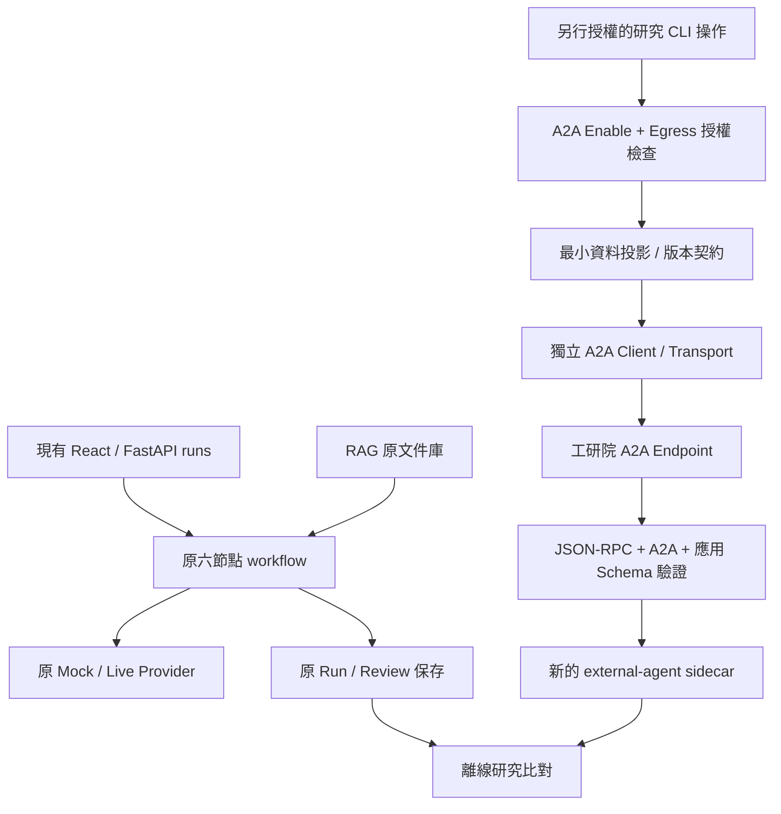

# A2A Integration Readiness Assessment

> 2026-10-28：本文是初期設計歷史。研究者已要求移除其中的本機 Grant／Operator／Approval 審批；現行獨立 Client、公開 Card 連線結果與操作方式以 [A2A_MINIMAL_CLIENT.md](A2A_MINIMAL_CLIENT.md) 為準。未接入六 Agent Workflow。

日期：2026-10-27。範圍：現有程式靜態分析、官方協定比對與整合提案。**未向工研院 endpoint、Agent Card 或其其他路徑發送任何請求**，未讀取／使用／輸出真實憑證，未執行模型或測試。本文所有新增模組／設定／JSON 均為設計，尚未實作。

證據標記：**已確認**＝本機原始碼或官方規格；**對方資訊**＝使用者轉述；**待確認**＝工研院部署與業務契約；**建議**＝本系統的整合決策。HTTP 可達、Token 有效、實際回應、費用與臨床能力均未驗證。

## 1. 結論與最小方案

架構可以新增獨立 A2A Client，但目前沒有可直接替換的 A2A Provider。推薦先建立**停用為預設、由明確操作啟動的獨立 Adapter／CLI**，將外部結果存成新的研究 sidecar，保持六節點、Mock/Live、RAG 與既有 Run/Evaluator 的資料流原樣。先完成傳輸／Schema 驗收，再討論外部 Agent 的角色映射。

不能把 `/a2a` 填入 LLM_BASE_URL 就完成接入：現有 Provider 會附加 `/chat/completions` 並傳另一種 body。也不能將外部文字回覆直接塞入 Synthesis 或視為 Audit 通過。

工研院提供 endpoint：`https://antibiotic-a2a.furryland.uk/a2a`。這是對方提供的服務位置，本輪沒有測試其可達性或擁有者身分。

## 2. 現有架構與擴充界線

| 模組／程式碼依據 | 已確認行為 | A2A 整合含義 |
| --- | --- | --- |
| `backend/app/providers/service.py:143`、`:174`、`:280` | OpenAICompatibleProvider 使用 Chat Completions；get_provider 僅 mock/live/unconfigured；可注入 http_post | 可借鏡傳輸替身、HTTPS、拒絕 redirect、錯誤代碼；不能重用其 body/parser 當 A2A Client |
| `backend/app/agents/runtime_v2.py:104`、`:122` | AgentProvider.complete(agent,data,timeout) 傳 system/user、output_schema、model，解析 choices；runtime transport retries=0，由工作流追蹤嘗試 | 此方法是可辨識的局部擴充邊界，但不是通用遠端 Agent 協定。A2A 可能有長任務／多輪，不能假設一次 complete 等價 |
| `backend/app/agents/runtime_led.py:68`、`:78` | 六角色定義；Provider 繼承 AgentProvider；送出前作 chunk aliases、source spans、AST source options，回傳後恢復與驗證 | 不是任意 JSON 都能替換。外部服務若不接受這些契約，需明確 mapper；不得偽造 refs/spans |
| `backend/app/workflow/engine.py:382` | execute 僅四種 mode、三種 provider；multi-agent 直接路由 agent_led.execute | 直接新增 provider_kind=a2a 或新 mode 會牽動 API／測試；第一階段不碰此路徑 |
| `backend/app/workflow/agent_led.py:258`、`:348`、`:415` | 順序構造 role inputs；Synthesis 合併前四報告；Audit 取聲明與原始來源；有 deadline、attempts、checkpoint、schema/來源驗證 | 外部結果先隔離；日後如選擇替代一角色，仍須通過角色輸出與來源驗證，不能繞過發布門檻 |
| `backend/app/main.py:42`、`:243` | RunBody 固定 mode/provider enum；同步 start_run、revision snapshot、checkpoint、保存與匯出 | 長 A2A task 不宜直接阻塞此 API；先獨立 CLI，日後才設獨立 job/API 與權限，不修改既有 /api/runs 契約 |
| `backend/app/workflow/input_context.py:6`、`agent_led.py:51` | RAG 片段包含 text/version/population/來源識別；facts 包含臨床欄位 | 不只是簡短病歷摘要；自動轉送完整 role input 可能包含敏感資訊與具授權限制的文件 |

搜尋 backend/app、frontend/src 與依賴清單，未發現 A2A Client、Agent Card discovery、SendMessage 或 JSON-RPC dispatcher 實作；亦無專用 A2A SDK 依賴。既有擴充點為 Python Provider 呼叫與可注入 transport，不是已完成的外部 Agent plugin registry。`requirements.lock.txt` 已有 Pydantic、httpx；最小 HTTP Adapter 可以先不增加依賴，仍須實作並驗證所選協定 profile。

## 3. 協定版本與對方契約：已知及未知

對方資訊：POST、JSON-RPC 2.0、method=SendMessage、Bearer header、application/json、message.role=ROLE_USER、message.parts=[{text:"INF000044"}]。

**JSON-RPC 2.0 是 RPC envelope 版本，不是 A2A 版本。** 官方 A2A 1.0 JSON-RPC 採 PascalCase 方法；0.3 的 JSON-RPC 則用 message/send。對方形式與 1.0 一致是推論，不能據此宣稱其完整符合 1.0。[官方 1.0 §9](https://a2a-protocol.org/v1.0.0/specification/#9-json-rpc-protocol-binding)、[官方 0.3 §7](https://a2a-protocol.org/v0.3.0/specification/#7-protocol-rpc-methods)。

1.0 還定義 messageId、`A2A-Version` header（例如協定版本值 `1.0`）與 task/message 回應分支；需要對方確認完整範例、支援版本及是否有自訂差異。應鎖定 profile，不能失敗後自動換成 0.3 重送。[官方 1.0 §3.6、§4、§9.4](https://a2a-protocol.org/v1.0.0/specification/)。

### 3.1 資料契約差異

| 契約 | 現有 Chat Completions | 工研院 A2A：已知／待確認 |
| --- | --- | --- |
| 路徑／方法 | base_url + /chat/completions，POST | 對方提供 /a2a，POST JSON-RPC；不附加模型路徑 |
| Request envelope | model、messages、temperature、response_format、max_tokens | jsonrpc、id、method、params；精確 params 依版本確認 |
| 發話內容 | system instruction＋user JSON 與 output_schema | ROLE_USER text part；尚未證明支援 system prompt、output_schema 或自訂 structured data |
| 輸入語意 | 明確病例／AST／檢索片段 | INF000044 意義不明：可能是遠端資料代碼、任務或病例 key；不等同本機 case_id，不可推定為可公開的測試字串 |
| 完成輸出 | choices[0].message.content 可解析為角色 JSON | 1.0 標準預期 result.task 或 result.message；工研院實際格式、artifact schema、文字/JSON 部位未知 |
| 進度／狀態 | 現有每次 complete 預期可結束 | 可能 task／中斷／需輸入；HTTP 200 或 Task 存在不代表分析完成 |
| 資源 | 有限 provider usage、finish_reason | Token/model/cost 非本次已知契約，缺漏必須 null，不補成 0 或借用本地模型名 |
| 認證 | LLM_API_KEY → Bearer | 獨立新核發 ITRI_A2A_API_KEY → Bearer；不共用 LLM_KEY，不放 body／前端 |

### 3.2 Agent Card 與回應處理

官方 Card 描述服務能力、介面與認證；可由對方直接提供 Card 檔案／URL，不必每次自動 discover。常見 well-known 路徑是 `/.well-known/agent-card.json`，不能假定部署在 `/a2a` 底下。1.0 的 supportedInterfaces 與 0.3 的 preferredTransport/additionalInterfaces 不應混解析。公開 Card 與認證後 Card 的位置／權限須向對方取得；**本輪連 Card 都沒有抓取**。[官方 Agent Discovery](https://a2a-protocol.org/latest/topics/agent-discovery/)、[1.0 Agent Card §8](https://a2a-protocol.org/v1.0.0/specification/#8-agent-discovery-the-agent-card)。

建議先要求一份離線 Card snapshot 與成功／失敗 response fixtures，核對 protocol、service version、skills、輸入輸出 MIME、streaming、GetTask/CancelTask 能力及 security scheme。Card 不是執行指令，不能讓回傳 URL 自動覆寫核准 endpoint 或把 token 傳到另一主機。

依確認 profile 實作解析：先驗證 HTTP/content type/大小，再檢查 JSON-RPC version、id 對應、result/error 分支與 A2A payload；1.0 的 task/message 是不同回覆形態，不能用 choices parser。Task 的狀態與 artifacts 才決定可用結果；message 亦要通過應用層內容契約，不能因有文字就當最終答案。若未完成或需輸入／認證，回 pending/needs_input 等獨立整合狀態，不能自動補資料續問。[官方 task lifecycle](https://a2a-protocol.org/latest/topics/life-of-a-task/)。

如對方只提供非標準 payload，以獨立 custom profile 記錄差異，不默默包裝成標準成功。

### 3.3 請求形狀示意（未送出、不是工研院驗收範例）

```json
{
  "jsonrpc": "2.0",
  "id": "client-request-example",
  "method": "SendMessage",
  "params": {
    "message": {
      "messageId": "client-message-example",
      "role": "ROLE_USER",
      "parts": [{"text": "INF000044"}]
    }
  }
}
```

messageId 是否必填／允許格式、版本 header、configuration 與 tenant 欄位須由對方確認後才鎖定。此例只表示 envelope，不表示 INF000044 已被批准可查詢；不包含任何憑證值或可直接執行的連線命令。

## 4. 建議獨立架構



第一階段沒有 E→W 的箭頭；外部輸出不流入六角色、候選集合或人工 Review 原紀錄。必要時以 parent_run_id/hash 作研究關聯，不把新內容追加到既存 Run。

建議新增（全未建立）：

```text
backend/app/integrations/a2a/
  config.py       default-off、endpoint/profile、runtime secret、timeouts
  contracts.py    版本化 request/response、外部整合結果與錯誤契約
  client.py       transport injection、JSON-RPC envelope、task 狀態
  service.py      egress gate、最小投影、應用驗證與 sidecar 整理
backend/scripts/probe_itri_a2a.py   顯式 dry-run / send 分開的 CLI
backend/tests/integrations/a2a/    injected transport + 無敏感資料 fixtures
```

最少四模組＋一 CLI＋測試；redaction/egress helper 初期可由 service 擁有，不擴張全域 Provider registry。若服務實際僅回應代碼查詢，service 只做該契約，不假裝它可以處理任意 role input。SDK 選擇須待協定版本確認；不先安裝整套工具或改 lockfile。

設定提案（只列名稱／語意，不設定實際環境）：

| 設定 | 建議 |
| --- | --- |
| ITRI_A2A_ENABLED | 預設 false；import、startup、/health、/config 都不得隱含連線 |
| ITRI_A2A_ENDPOINT | 伺服器端核准的完整 HTTPS URL，禁止 userinfo；不能接受任意瀏覽器輸入 URL |
| ITRI_A2A_PROTOCOL_PROFILE | 須明確確認後指定，未知版本拒絕；對應 parser／版本 header |
| ITRI_A2A_API_KEY | 僅在 runtime 由安全環境注入；不得進文件、Git、fixture、response、repr 或 VITE_* |
| ITRI_A2A_CONNECT_TIMEOUT_SECONDS / READ_TIMEOUT_SECONDS / TOTAL_DEADLINE_SECONDS | 初始可提議 5/30/45 秒，待服務 SLA 與單次費用確認；不是對方已承諾的時間 |
| ITRI_A2A_MAX_RESPONSE_BYTES / MAX_POLLS | 有上限；初版不自動 poll，必要時才加入有 deadline 的 GetTask |

Egress consent 不只是一個環境變數：每次操作至少關聯研究用途、核准資料範圍、操作者、目的 endpoint、核准記錄與有效期限；不因持有 token 就默認允許傳送任意病例。

## 5. Timeout、錯誤與觀測設計

| 情況 | 建議 Adapter 行為 |
| --- | --- |
| 未啟用／缺設定／缺授權 | 在建立網路請求前拒絕；不輸出 token 值，不探測服務 |
| TLS／DNS／connect/read timeout | 安全錯誤碼＋request correlation；timeout 不代表遠端 task 沒有建立 |
| 301/302 等 redirect | 拒絕，不將 Bearer 轉送另一位置；Card URL亦需事先核准 |
| 401/403 | auth/config failure，不自動重試或將認證內容交給 LLM |
| 429/5xx | 記錄可否重試與限流；SendMessage 初版不自動重送，先確認遠端冪等／去重契約 |
| HTTP 200 + JSON-RPC error | 視為 RPC failure，不視為成功答案；僅保留安全 code，不原樣記錄 error.data/body |
| ID 不符、result/error 畸形、未知 profile、超大或非 JSON | protocol/schema invalid，隔離；不從 HTML/文字猜修成合法分析 |
| task 尚未完成／input_required/auth_required | 狀態保留；不當成六節點完成，不偷偷提交更多病例資料或換憑證續跑 |
| artifact URL/file/意外 MIME | 初版拒絕或標 unsupported；不自動下載、執行或跟隨外部內容 |
| 外部分析 Schema 不合 | application_output_invalid；不得填缺藥列、編造 quotes 或把自由文字硬轉成通過 Audit |

JSON-RPC id、messageId 與遠端 taskId 用途不同；唯一 ID 本身不保證安全重試。確認 dedup/idempotency 行為前，一次明確 send 對應一次發送；client timeout 後使用已取得 taskId 查詢（僅若對方支援），不得自動建立第二份分析。HTTP timeout、poll 與應用 deadline 分開記錄，總 deadline 還須涵蓋解析與等待。

日誌採 allowlist：local correlation ID、profile/Card hash、HTTP status、RPC code、安全化 task state、elapsed、bytes、attempt/poll counts、usage completeness。不要記 Authorization、環境 dump、請求全文、遠端錯誤全文、病例代碼或含敏感內容的 URL。既有 `runtime_v2.redact` 只作鍵名／特定 secret 字樣過濾，不是完整病歷去識別，也不能保證遮住所有 API key 格式。

研究 sidecar 與一般 log 分離：sidecar 可保存經核准／最小化的 request/response snapshot 與 provenance，仍需權限、保存期限與原文存取控制；一般 log 不存 body。檔案 hash可作完整性核對，不等於匿名化，低熵病例代碼不靠 hash 視為已去識別。

## 6. 外部資料傳送的實際限制

**重要原始碼事實**：Case.external_model_allowed 在 `schemas/case.py:162` 已標 deprecated；`runtime_v2.AgentProvider.check:112` 對 synthetic 或 data_origin=deidentified/hybrid 的 Live 輸入檢查，並不依這個舊欄位阻擋。`tests/test_agents_v2.py:361`、`tests/test_providers.py:173` 明確測試 legacy consent 不作控制。因此「病例欄位是 false」不能當成現有外傳保護；本輪不修改此既有行為。

建議 A2A 新服務採獨立 default-deny gate，核實機構／研究資料使用與服務端處理授權後才送出。這是新整合的前提，未把一般本機測試授權推廣成外部資料使用許可。

需評估的輸入包含：病例代碼可能可連回遠端個案；自由文字、日期、罕見事件／藥物組合可能可再識別；AST 與 hybrid 人工臨床情境仍有真實來源部分；RAG 原文可能有文件使用／轉傳限制。deidentified/hybrid metadata 與 secret redaction 均不足以證明可外傳。初版僅接受對方明確批准的 synthetic/test reference，不送本機病例、RAG chunks、既有 Run/Review、Gold、醫師姓名或完整追蹤。

若未來傳送本機結構化資料，需事先定義字段白名單、資料主體／研究授權範圍、服務營運者與處理地點、下游模型、保存／刪除期限、是否用於訓練、存取控制及事故通報；由適當機構人員確認。若政策不明則停止該資料傳送，不以「遠端是工研院服務」代替核實。

官方亦將 HTTPS、認證、授權及資料保密分開處理；Bearer 驗證不等於具備使用所有資料的權限。[官方 Enterprise Features](https://a2a-protocol.org/latest/topics/enterprise-ready/)。

## 7. 未來接入六節點的位置評估

| 位置 | 可行前提／主要風險 | 建議順序 |
| --- | --- | --- |
| 六節點之外的 shadow external agent | 外部回答獨立保存；不影響原候選、RAG 或 Audit；確認對方任務與病例對齊 | **第一優先**；可先作功能與研究比較 |
| case_agent | 能接受最小病例 facts 並回 CaseReport；不得冒充原病例來源 | 不因服務名稱有 antibiotic 就假定支援 |
| ast_agent | 必須保留全 AST index、basis、category_source_refs，並映射至 ASTReport；未知代碼不能代表本機 AST | 待 A_source 政策與來源歸因完整；現有碼查詢契約不足以證明可替代 |
| evidence_agent | 能回可追溯原文、版本、定位與感染／族群適用性；外部 refs 不是本地 chunk_id | 可作候選研究位置，但先獨立 namespace/source snapshot，不能把外部結論偽裝成本地 RAG 證據 |
| clinical_agent | 能處理過敏／腎功能／用藥，回逐項 risk_details 與來源；資料外傳範圍更大 | 高需求；需語意與安全 Gold，不能先當免驗證判斷器 |
| synthesis_agent | 需接受同一組 specialist reports、藥物 universe、五維度 claims；外部服務不能暗用未知病例／證據 | 僅在 controlled trial；不得直接發布外部建議 |
| evidence_audit | 需隔離上游 verdict、取得原始 facts/evidence、逐 claim checks 與 refs；模型可能與外部 Synthesis 共源 | 最後考慮；外部服務的自我評分不能作獨立 Gold 或直接取代發布驗證 |

以上是未來研究候選位置，不是本輪變更。若工研院只支援 INF 代碼查詢，其最小定位就是外部查詢服務，不能直接稱已支援六種角色。要接回任一角色，必須另批准 workflow 版本、mapper、timeout budget 與 regression 範圍。

## 8. Mock 測試與最小交付順序（未執行）

1. **契約確認**：取得離線 Card、版本、合法 synthetic reference、成功 message/task 與錯誤樣本、收費／SLA、資料處理條款。不需先連服務。
2. **獨立 Client＋dry-run**：四模組、CLI、設定驗證；預設停用、零 import/startup egress，產生 request 供本地檢查。固定一個協定 profile，不改 LLM_PROVIDER。
3. **Injected transport tests**：可用既有 httpx.MockTransport 或小型 callable。測試正常 message、completed/pending task、RPC error、401/403/429/5xx、timeout/未知送達狀態、錯 ID、錯版本、兩種 result 同時存在、超大／非 JSON、惡意 URL、redirect、輸入授權拒絕與 log redaction。測試只用 toy資料／執行時生成的測試認證，不放真實 key 或患者範例。
4. **保護既有功能**：disabled 狀態不能增加六節點呼叫、改候選或資料庫；原 Mock/Live Provider 契約測試、六節點／RAG/Audit regression、Evaluation/dataset tests。若日後動 API/UI，再擴大前端 build／component／Playwright。輸出到新研究目錄，前後核對原 DB/Run/Review/index hashes。
5. **首次明確授權連線**：只對已核准測試 reference 發一次 SendMessage；Token 新核發、runtime 注入、所有輸出遮蔽。先確認是否產生成本；首輪禁止 retry/push/webhook/file retrieval，自動輪詢預設關閉。只有 profile/schema/state 與預期 fixture 相符才算協定 smoke pass，不稱臨床分析通過。
6. **Shadow 比較**：新 sidecar、版本化輸入及保存結果；通過後才提出角色映射實驗，不直接改原 workflow。

第一次連線前可由工研院提供 Card 檔避免 discovery；如需 GET Card，亦須列入操作授權與可訪問 URL 範圍。本輪不提供或執行任何會發送 request 的命令。INF000044 必須先確認是可授權 synthetic fixture，再使用；「只送一個 ID」仍可能觸發有費用或會存取真實資料的工作。

## 9. 整合風險與向工研院確認事項

| 必須確認 | 未確認時的風險／處置 |
| --- | --- |
| 精確 A2A 版本、JSON-RPC method 大小寫、版本 header、custom profile、完整 request JSON、messageId/tenant | 版本混用；拒絕猜測 fallback |
| Card 檔／URL、是否需認證、service/skill version、輸入輸出 MIME、endpoint/card 的信任關係 | 無能力宣告／不當 redirect；不做自動 endpoint 替換 |
| INF000044 的含義、合法測試代碼、是否讀遠端病例／工具／資料集、能否接受本機資料、哪些角色能力 | 隱藏資訊／費用／資料越權；只允許明確批准測試範圍 |
| SendMessage 的 message/task/artifact 範例、structured analysis schema、引用來源／版本／locator | 無法安全映射 AST/Risk/Claims；僅保存獨立結果，不轉本地候選 |
| GetTask/CancelTask/SSE、所需輸入／認證、終止條件、最大執行時間與取消後狀態 | HTTP timeout 與遠端 task 分離；不把逾時當未執行或已取消 |
| 冪等／重複 messageId 規則、速率限制、Retry-After、Token scope/到期/輪替、IP allowlist | 重複分析、漏費用、認證失敗；不盲目 retry |
| 收費、單次預算、usage/model/version 可見性、失敗或取消是否計費 | 無法做成本公平比較；未知記 null |
| 資料保存／刪除、下游模型／處理地點、訓練用途、權限、稽核與資料使用授權 | 不傳本機病例／RAG／Gold，先完成機構審查 |

## 10. 納入研究比較的方式

先當**外部 end-to-end condition**，不要標成原 six-agent 的一次一般 Live 呼叫。sidecar 記 endpoint profile、Card/service/version hash、輸入／輸出 hash、request/message/task 關聯、可見資料來源、elapsed 邊界、失敗/中斷、完整/缺失 usage、應用 Schema 驗證結果；不存 secret。

若外部只收遠端 INF 代碼，而本地模型收 handoff facts，兩者資訊不相同。必須取得相同病例 revision／AST／藥物集合及外部可見證據的證明，否則只作不同系統描述，不宣稱 Agent 架構造成差異。遠端可能有內建 RAG、模型、規則、記憶、工具，需記錄未知項與資料洩漏風險；服務不透明時不能做「只有 Agent 分工不同」的因果結論。

後續 controlled ablation 可固定同一 evidence pack、drug universe、模型/服務版本、Gold、資源預算與多次 trial，分別比較 shadow、單角色替代或外部 end-to-end；不得同時改協調與檢索後將增益全歸因 A2A。使用相同獨立 A_source／文件／專家 Gold，外部答案與自評不可作 Gold；目前 provisional 仍不能評正式品質。

原 Offline Evaluator 保持唯讀。外部結果先存自身 schema；只有資料與能力足以對齊時，才另行設計 evaluation adapter／capability matrix。無該角色、來源 refs 不可比、沒有 token/cost、無獨立 Gold 時保留 not_evaluated/missing_gold，不偽造六節點或填零。任何會改 Evaluator／workflow 的實作屬後續任務。

本輪交付只有這份整合計畫；下一步最小工作是取得工研院完整契約及授權的測試 fixture，再另行授權實作獨立 Adapter 與離線 Mock 測試。
