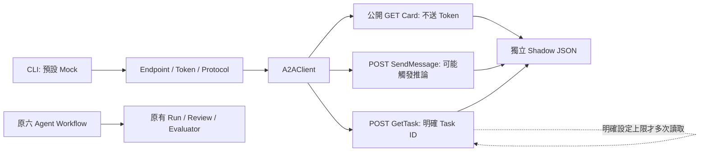

# Minimal ITRI A2A Client

日期：2026-10-28（Asia/Taipei）。Workspace：`C:\Users\呂宜學\Documents\ChatGPT\multi_agent`。
Git 基準：main，`1ad2648a349c28989c9fa3d41cd37bf56a40f0fd`；本輪未提交 Commit。

## 1. 已確認契約與移除項目

依據為 `docs/itri_agent_card.json`、對話中工研院提供的 POST／SendMessage 範例，以及官方 A2A 1.0 規格。未找到其他獨立供應商 API 或 curl 檔案；不能把先前 Codex 文件中的建議當作供應商要求。

已移除 EgressGrant、operator、purpose、approval_record、expires_at、synthetic-reference grant scope、Grant 檔案讀取、`--authorize-egress`、`--grant-file`、`ITRI_A2A_ENABLED` gate，及只測試這些機制的案例。上述欄位都不在工研院 Card／已提供的 SendMessage 契約中。

協定 profile 預設為 `a2a-1.0-jsonrpc`，不需額外設定；不自動降版重送。`--live` 保留為 CLI 的 Mock／網路模式切換，不是核准流程。直接呼叫 A2AClient 只需要有效 Endpoint、Token 與輸入。

保留 TLS 驗證、HTTPS、標準 Bearer Header、JSON-RPC ID／messageId、A2A-Version、基本輸入／回應驗證、Timeout、大小限制與 Secret Redaction。不記錄 request body／Authorization 或遠端錯誤全文。Token 必須是原始 Bearer credential，不包含 `Bearer ` 前綴；格式檢查不代表伺服器驗證。

2026-10-28 後續格式修正：移除先前 `[A-Za-z0-9._~+/=-]+` 的 Token 字母表假設，改為 HTTP Header 安全檢查（非空、所有字元介於 ASCII 0x21–0x7E）。拒絕空白、CR／LF、控制字元、DEL 與非 ASCII；不 Trim、不刪除或替換 Key。這是對供應商 opaque credential 的傳輸相容處理，不宣稱任意字串均符合標準 Bearer token 語法或已通過認證，最終由工研院服務判定。Bearer／TLS／不重試行為不變。

既有歷史 Grant 檔／測試報告未刪除或改寫；現行程式不再讀取它們。其他 Mock／OpenAI runtime helper 中若仍設定 `ITRI_A2A_ENABLED=false`，對現行 A2A Client 沒有作用；這些既有研究啟動檔本輪未修改。

## 2. 架構與界線



所有資料仍標為 untrusted、clinical_decision_eligible=false、gold_eligible=false。usage／estimated_cost 未知維持 null。沒有 A2A → Workflow 路徑，也不自動讀取病例、RAG、Run 或 Review。CLI 不提供自動載入病例檔的參數；使用者仍須確保輸入為核准的合成資料。

核心檔案：

- `backend/app/integrations/a2a/config.py`：環境變數；不讀 `.env`、不讀 LLM_API_KEY。
- `contracts.py`：SendMessage、GetTask 與 RPC／Message／Task 基本驗證。
- `client.py`：單次 HTTP；`get_agent_card`、`send_message`、`get_task`。
- `service.py`：Shadow envelope 與明確有界 `poll_task`。
- `backend/scripts/probe_itri_a2a.py`：獨立 CLI。

每次方法最多一個 HTTP request，HTTPTransport retries=0，follow_redirects=false，trust_env=false，TLS verify=true。讀取 Timeout 預設 30 秒、connect 5 秒、elapsed budget 45 秒；elapsed budget 不是可強制中斷 DNS 的硬性 watchdog。錯誤立即停止，不重試；Timeout 不能證明遠端任務未執行。

## 3. 最少設定與安全輸入 Token

必要：`ITRI_A2A_ENDPOINT`、`ITRI_A2A_API_KEY`。後者是工研院 Token，不能使用 OpenAI 的 `LLM_API_KEY`。版本、版本 Header、Timeout 可沿用預設。

在新的 PowerShell 視窗執行。以下只輸入 Key，不發送任何請求，不寫入磁碟／永久 PATH／永久環境變數：

```powershell
Set-Location -LiteralPath 'C:\Users\呂宜學\Documents\ChatGPT\multi_agent\backend'
$env:ITRI_A2A_ENDPOINT = 'https://antibiotic-a2a.furryland.uk/a2a'
Remove-Item Env:ITRI_A2A_API_KEY -ErrorAction SilentlyContinue
$taskSecret = Read-Host '輸入工研院 A2A Token（不是 OpenAI Key；不含 Bearer）' -AsSecureString
$taskPointer = [IntPtr]::Zero
try {
    if ($taskSecret.Length -eq 0) { throw 'Empty credential.' }
    $taskPointer = [Runtime.InteropServices.Marshal]::SecureStringToBSTR($taskSecret)
    $env:ITRI_A2A_API_KEY = [Runtime.InteropServices.Marshal]::PtrToStringBSTR($taskPointer)
    Write-Host 'Token loaded in this window only. No request sent.'
}
finally {
    if ($taskPointer -ne [IntPtr]::Zero) {
        [Runtime.InteropServices.Marshal]::ZeroFreeBSTR($taskPointer)
    }
    $taskSecret.Dispose()
    Remove-Variable taskSecret,taskPointer -ErrorAction SilentlyContinue
}
```

同一個視窗內的 CLI 子程序才會繼承 Token；不需要重啟 FastAPI。不要顯示 `$env:ITRI_A2A_API_KEY`。完成所有獲准測試後清除：

```powershell
Remove-Item Env:ITRI_A2A_API_KEY -ErrorAction SilentlyContinue
```

## 4. A／B／C／D 分階段指令

以下 CLI 命令 cwd 都是上述 backend。只有 A 曾實際連線；C／D 是未執行的後續操作範例。

### A. 公開 Agent Card：一次 GET，不讀取／傳送 Key

```powershell
& .\.venv\Scripts\python.exe -X utf8 -B -m scripts.probe_itri_a2a --live --card
```

預設 URL 為 Endpoint origin 的 `/.well-known/agent-card.json`；不跟隨 Redirect，不採用 Card 內的 URL 修改設定。可用 `--card-url` 指定對方確認的同源 URL。本輪已完成一次 GET，無需為展示重送。

### B. Token 認證：尚未測試

對方未提供獨立、保證不觸發推論的 auth-check 路由，Card 也未宣告。公開 Card HTTP 200 不驗證 Bearer；不能以它宣稱 Token 有效，也不應發明 probe method 或亂送病例碼。

可請對方提供免推論認證路由，或一筆有權讀取的合成 Task ID，再以 D 的一次 GetTask 測試。另一選項是研究者明確批准 C 的一次 L1；此時認證與模型呼叫一起測試，可能計費。

### C. L1：先預覽，再等待推論／費用批准

以下預覽完全離線；問題是無病人資料的合成測試文字，不是已獲批准的推論：

```powershell
& .\.venv\Scripts\python.exe -X utf8 -B -m scripts.probe_itri_a2a --dry-run --text 'MIC 怎麼判讀？'
```

**下列才會送出 SendMessage，可能使用模型／計費，本輪未執行；須先取得明確批准。**

```powershell
& .\.venv\Scripts\python.exe -X utf8 -B -m scripts.probe_itri_a2a --live --text 'MIC 怎麼判讀？'
```

不自行新增 `skillId`、L1 header 或 metadata：Card 宣告 Skill 不等於定義 routing 欄位。需由供應商確認此問句如何路由及實際回應標記，不能僅因收到文字就宣稱 L1 已驗收。

### D. L3：先確認合成 reference，再另行批准提交

Card 的 INF000055／歷史範例 INF000044 未被核實為可授權合成資料，不能直接拿來送。以下變數必須由研究者填入已核准 reference，不能當現成可執行測試：

```powershell
# 僅於取得明確批准後；先在本機設定 $taskApprovedSyntheticReference。
& .\.venv\Scripts\python.exe -X utf8 -B -m scripts.probe_itri_a2a `
  --live --text $taskApprovedSyntheticReference --return-immediately
```

送出 `configuration.returnImmediately=true`；若對方支援並回 Task，記下 `result.payload.id`。不自動 Polling，不重新 SendMessage。

```powershell
# 將 $taskReturnedTaskId 設為實際回覆的 Task ID；一次狀態查詢。
& .\.venv\Scripts\python.exe -X utf8 -B -m scripts.probe_itri_a2a --live --task-id $taskReturnedTaskId
```

這是 JSON-RPC `GetTask`，params 為 `{id: Task ID}`，預期 result 直接是 Task。若需要明確有界輪詢，可額外設定 `--poll-count 3 --poll-interval 2`（最大 5 次）；本輪沒有使用。遇終止／INPUT_REQUIRED／AUTH_REQUIRED 即停止，錯誤不重試、不補資料、不自動續問。

CLI exit 0 只表示傳輸與解析成功。WORKING 是未完成；FAILED／REJECTED 等不是成功分析。HTTP 401／403 是 HTTP_ERROR；HTTP 200 下的 RPC_ERROR 會同時保存 http_status=200 與數字 rpc_code。HTTP status=null 通常代表未收到 HTTP 回覆或在本機拒絕，不能虛構 401。

## 5. 本輪驗證與限制

- Minimal Client 初版 A2A Unit Tests：108 passed，0 failed／errors／skipped，0.52 秒。
- 本次 Header 格式修正後 A2A Unit Tests：148 passed，0 failed／errors／skipped，0.59 秒；涵蓋 32 種 ASCII 標點原樣傳送及回覆遮蔽、Header 注入拒絕與遠端 401。全部使用合成 credential／MockTransport，未使用真實 Key，未發送 Live 請求。證據：`data/runtime/a2a-header-check-20261028-106ctlzq/unit.xml`。
- 前次 Backend Regression：592 passed，0 failed／errors／skipped，20.03 秒，4 個既有框架棄用警告；包含 A2A、Evaluation 與原有六 Agent 測試，不可再加總。本次只修改獨立 A2A 設定檢查與相關測試，未重跑完整 Backend Regression。
- 第一輪 Unit 的 oversized fixture ID 超過 Windows 環境變數長度上限；只修正顯示 ID，保留 oversized 測試。原結果保存為 unit.xml，最終為 unit-final.xml。
- 第一輪 Regression 有 3 個 Windows 子程序解碼 thread warnings；只為本輪 runner 加上 PYTHONUTF8／PYTHONIOENCODING，再以新目錄重跑。舊報告保留。
- 唯一外部操作：公開 Card GET，HTTP 200、attempts=1，無 Authorization／body／Retry／Redirect；未呼叫 `/a2a` POST。
- Card 名稱、Protocol 1.0 與兩個 Skills 已確認；遠端 payload 與本機 JSON 正規化後一致，SHA256：`8e1f1a30e86fdf23d2c439ccf7e8b43cd7592415c3423499294d083c50503ab9`。
- B Token 驗證、C 真實 L1、D 真實 L3／GetTask：均未執行，HTTP／RPC code 為未取得，不填 0。
- 未讀取或使用真實 Token；尤其沒有使用已重新設定給 OpenAI Backend 的 Key。
- Task／Artifact parser 是可測試的協定子集，尚需工研院實際 fixture 驗收；不支援檔案 parts、SSE、Push、取消或多輪續問。
- 原始病例、Run、Review、醫療文件與核心 Workflow 應以本輪 preservation.json 為準；本輪未停啟任何日常服務。

證據目錄：`data/runtime/a2a-minimal-20261028-l0xiwj_0/`，含 before.json、unit-final.xml、regression-final.xml、public-card-once.json、preservation.json 與隔離 runner。測試 runner 封鎖外網，所有憑證只在測試子程序移除，使用獨立 DB／temp；不需 LLM API、Ollama 或 GPU。

## 6. 下一步

解析失敗診斷功能已新增：CLI 可選 `--diagnostic-out <全新檔案>`，HTTP 200 但 Message／Task 解析不符時保存遮蔽憑證的回應 JSON，保留原錯誤與 exit code，不重試。用法、無效 JSON 的保守省略政策及最新測試結果見 [A2A_RESPONSE_DIAGNOSTICS.md](A2A_RESPONSE_DIAGNOSTICS.md)。不提供此參數時行為不變；此功能無法還原先前未保存的回應。

後續已依工研院實際去敏回應加入 direct Task 相容解析，SendMessage／GetTask 同時接受 `result.task` 與直接的 `result` Task，仍共用必要欄位與狀態驗證；拒絕混合包裝。此次 A2A 242 tests passed，未發送任何網路請求。既有 Task 的唯一一次查詢指令與 fixture 來源見 [A2A_TASK_RESPONSE_COMPATIBILITY.md](A2A_TASK_RESPONSE_COMPATIBILITY.md)。

1. 使用者在本機輸入新工研院 Token，與 OpenAI Key 分開，不貼聊天、不寫檔。
2. 向供應商確認免推論認證路徑、Skill routing、合成 reference 與 GetTask／artifact 範例。
3. 如願接受一次可能付費的 L1 推論，再取得明確批准，單次送出，保存遮蔽結果；失敗停止。L3 需另外批准，不因 L1 批准而自動提交。

官方依據：[A2A 1.0 SendMessage／GetTask／returnImmediately](https://a2a-protocol.org/v1.0.0/specification/)、[Agent Discovery](https://a2a-protocol.org/latest/topics/agent-discovery/)。這些是標準契約，不代表工研院每項能力都已驗收。
