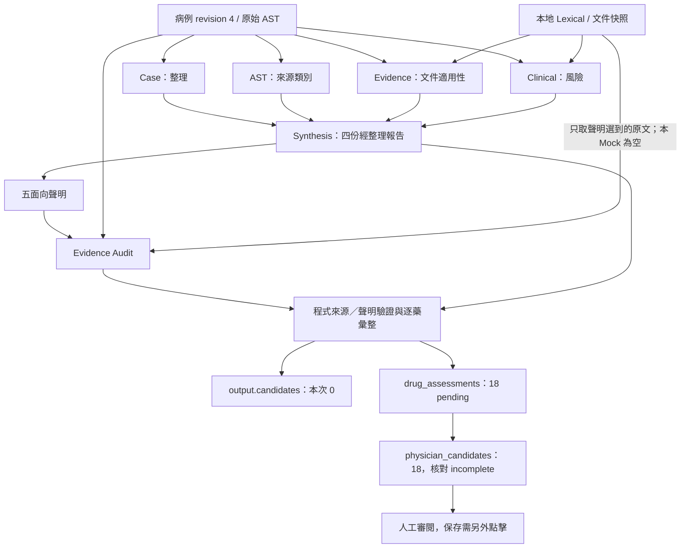

# Multi-Agent 網頁研究工作台：教授 Meeting Demo 與操作手冊

核對日期：2026-10-27。專案：`C:\Users\呂宜學\Documents\ChatGPT\multi_agent`。適用 Workflow：agent-led-1.6.0；HEAD：`1ad2648a349c28989c9fa3d41cd37bf56a40f0fd`。本文以本次實際原始碼、唯讀 SQLite 與本機 GET 回應為依據；沒有重新分析、呼叫 Live／A2A、安裝套件或修改原始資料。

## 1. 明天報告的主軸與目前可展示資料

開場一句：「這是抗生素輔助決策的研究 Prototype，今天用保存的 Mock Run 展示資料流、來源追蹤與醫師覆核介面，尚不宣稱已驗證臨床推論能力。」

本次已確認：

| 項目 | 現況 |
| --- | --- |
| 本機服務 | `http://127.0.0.1:8000/api/health`、`http://127.0.0.1:5173/` 均 HTTP 200 |
| 執行中設定 | `/api/config` 回 provider.kind=mock、rag.retrieval_mode/method=lexical；24 份參考文件 |
| 日常隔離資料 | `data/runtime/mock-check/prototype.db`：28 cases、95 revisions、1 run、1 review、0 benchmarks |
| 文件索引 | `data/runtime/mock-check/documents/rag.sqlite3`：24 documents、2,111 chunks、0 embeddings |
| 代表病例 | agent-complete，current revision=4，18 筆 AST，data_origin=hybrid |
| 主 Run | `51905060-412e-4e04-99f3-c9a1bbbbc596`，UI 短碼 `51905060` |
| Run 狀態 | multi-agent、mock、partial／needs_confirmation；6 個 Agent 各 1 次 Mock attempt |
| 結果 | 18 drug_assessments，全部 pending；output.candidates=0；physician_candidates=18 |
| RAG | 74 次查詢、68 個去重 evidence snapshots；片段來自 19 個不同文件 ID |
| 用量 | usage=null；保存耗時 255.518 ms，只是這次 Mock 流程耗時 |
| 人工紀錄 | 1 筆既有 drug_review；測試用途，不能當醫師 Gold |
| API 可見性 | 六個 Agent 的 output 均可由既有 Run GET 取得；另有 candidate_presentation、human_review 非模型節點 |

病例 AST 來自來源資料；demographics、encounter、renal、allergies、medications、rapid_identification、clinical_history、vitals、medication_history_status 在 provenance.simulated_fields 明列為人工情境。UI「完整病例」不是實際患者完整病歷。此情境：尿液 E. coli、模擬下泌尿道感染、stable、eGFR 92、CrCl 84.1、known_none 過敏；數值不可講成真實患者觀察。

**畫面與舊文件的兩個陷阱**：

1. `App.tsx:498` 仍有「通常 5 次獨立模型呼叫」的過時提示；本 Run 是六 Agent、六 Mock attempts。另兩個呈現／人工步驟不是第七、第八個 AI Agent。
2. 現行 `AgentStep` 顯示摘要、逐藥表與理由／來源，沒有通用的 input/output JSON 展開鈕。`Insights.WorkflowStep` 的舊分支有輸入 JSON，但 agent-led 會提前改用 AgentStep。要講完整輸入／輸出，使用匯出 JSON 或 API，不能承諾 UI 上一定有該按鈕。

本次已核對 API 與 React rendering 分支；沒有在瀏覽器逐一點擊所有控制項。若實際畫面不同，以 Run ID／版本／截圖核對，再繼續教學。

## 2. Windows 啟動與停止

### 2.1 現在服務已在線：先沿用

在新的 PowerShell 視窗確認：

```powershell
Invoke-RestMethod -Uri 'http://127.0.0.1:8000/api/health' -TimeoutSec 5
```

預期 status=ok。前端網址：`http://127.0.0.1:5173/`；Swagger：`http://127.0.0.1:8000/docs`。Swagger 僅看 GET；不要按 POST 的 Execute。

安全設定的唯讀確認：

```powershell
$demoConfig = Invoke-RestMethod 'http://127.0.0.1:8000/api/config'
$demoConfig.provider.kind
$demoConfig.rag.retrieval_mode
```

預期 mock、lexical。若不同，先停止 Demo 分析操作，釐清正在連哪組服務。不要為了確認設定列印環境變數或憑證。

### 2.2 兩個服務都停止時：優先使用既有背景腳本

```powershell
Set-Location -LiteralPath 'C:\Users\呂宜學\Documents\ChatGPT\multi_agent'
if (Test-Path -LiteralPath '.\backend\.env') {
    throw '目前啟動流程以沒有 backend/.env 為前提；先核對，勿盲目啟動。'
}
Remove-Item Env:LLM_API_KEY,Env:LLM_BASE_URL,Env:LLM_MODEL,Env:ITRI_A2A_API_KEY -ErrorAction SilentlyContinue
$env:ITRI_A2A_ENABLED = 'false'
powershell -NoProfile -ExecutionPolicy Bypass -File .\data\runtime\mock-check\Start-Services.ps1
```

預期 `Ready: frontend http://127.0.0.1:5173 ; backend http://127.0.0.1:8000`。再打開前端網址。

腳本的 `Environment.ps1` 將 DB 固定到既有 mock-check、LLM_PROVIDER=mock、RAG_RETRIEVAL_MODE=lexical，使用專案 .venv 與本機 Node；不改永久 PATH。兩個 port 任一已占用會拒絕，不替換既有程序。腳本會寫本機 logs、PID 紀錄與確認 tmp 目錄；不是唯讀工具。

此組腳本與工具為 ignored 本機資產，已確認此電腦存在，其他 clone 不保證有。不要改用 setup/handoff 腳本來「重啟」，它們會安裝／匯入資料。原 backend/scripts/run.ps1 預設可能做 Ollama 檢查；本次優先使用 mock-check 腳本。

### 2.3 分別啟動 Backend／Frontend（排錯用）

先確定對應 port 未被既有服務使用。新 PowerShell 視窗 A：

```powershell
Set-Location -LiteralPath 'C:\Users\呂宜學\Documents\ChatGPT\multi_agent'
if (Test-Path '.\backend\.env') { throw '先核對新增的 .env。' }
Remove-Item Env:LLM_API_KEY,Env:LLM_BASE_URL,Env:LLM_MODEL,Env:ITRI_A2A_API_KEY -ErrorAction SilentlyContinue
$env:ITRI_A2A_ENABLED = 'false'
powershell -NoProfile -ExecutionPolicy Bypass -File .\data\runtime\mock-check\Start-Backend.ps1
```

視窗 B：

```powershell
Set-Location -LiteralPath 'C:\Users\呂宜學\Documents\ChatGPT\multi_agent'
powershell -NoProfile -ExecutionPolicy Bypass -File .\data\runtime\mock-check\Start-Frontend.ps1
```

兩個終端保持開啟。Vite `/api` proxy 指向 8000，port 5173 strictPort=true，不會偷偷換網址。前端無 React Router，六頁由 App 的 section state 切換；URL 都是 `/`。重新整理會清空選取狀態，要重選病例與 Run，不會刪除資料庫紀錄。

### 2.4 安全停止

- 背景 Start-Services 啟動：從根目錄執行以下命令。停止腳本比對 PID、時間與執行檔，不能假定能管理手動啟動的程序。

```powershell
powershell -NoProfile -ExecutionPolicy Bypass -File .\data\runtime\mock-check\Stop-Services.ps1
```

- 前景兩視窗：各按 Ctrl+C，等終端返回再關閉。
- 不在分析執行途中停止。後端啟動會將先前 running Run 標為中斷失敗；本次 DB 沒有 running Run。
- 不刪除 DB、SQLite WAL、索引或 PID 不明的程序。

## 3. 六頁操作地圖與按鈕風險

共同入口：左側導覽。共同選單「目前病例」選 agent-complete；切換病例會清除目前 Run 選取，返回病例工作台。

### 3.1 病例工作台

- **看什麼**：病例摘要、模擬／來源標示、過敏與腎功能、來源 AST、歷史版本、執行設定與「執行紀錄」。AST 表「原始報告」顯示 source_phenotype 優先，並非永遠顯示 reported_sir；CLSI 欄是資料集衍生值，系統沒有重新算 breakpoint。
- **讀取操作**：「目前病例」→ agent-complete · revision 4；展開「全部病例資料與轉換警告」「歷史版本」；在「執行紀錄」點短碼 51905060 的項目，自動進入分析結果。
- **寫入操作**：「載入已準備的來源病例」是 POST /seed；確認用藥、保存過敏、切換／保存文件範圍、建立／保存新版本、驗證並匯入都會寫資料，Meeting 不按。
- **模型操作**：「比較模式」有規則判斷、文件檢索＋模型、單次模型整合、獨立代理協作；「模型執行方式」有未設定、Mock、已設定模型。改選本身只改 UI state，按「執行分析」才 POST /api/runs、建立新 Run；Live 可能對外傳資料。這次不按執行分析。
- **適合 Demo**：來源 AST 與人工臨床情境如何分開、版本固定與歷史 Run 入口。
- **口頭稿**：「我先選第 4 版病例。AST 有來源欄位，其他臨床資訊是人工編製情境，介面保留這個差別。分析不是覆寫病例，而是保存當次版本的快照。今天直接讀已存的 Run，避免把現場模型變異混入系統展示。」
- **依據**：App.tsx:147、:311、:386、:462、:518；main.py:191、:196、:198、:218、:243。

### 3.2 分析結果

- **進入**：病例工作台的歷史 Run，或左側「分析結果」（須已選 Run）。
- **看什麼**：Run ID／Mock／狀態、病例版本、分析時的病例摘要、「逐藥分析總覽」、醫師候選／不建議／AI 完整核對數量、核對缺口。
- **操作**：「搜尋藥品」輸入 amoxicillin_clavulanate；「顯示範圍」切全部／醫師候選／不建議；按該列「展開」，看整合判斷、藥敏與原始報告、臨床風險初評、證據與獨立複核；展開「查看模型證據草稿（尚非建議）」與「未完成項目」。均為前端讀取／篩選。
- **匯出**：「匯出 JSON」讀 GET /api/runs/{id}/export，下載到瀏覽器下載目錄；不新增 Run，但匯出仍含研究資料，僅本機保存。
- **適合 Demo**：0 AI 完整核對 vs 18 醫師候選；以單一藥追原始 AST、Mock unknown、Pending。
- **口頭稿**：「這裡將 18 種藥逐項保存。醫師候選代表可供人工檢視，不代表 AI 已確認推薦。這次 Mock 沒有做來源及風險判斷，因此 AI candidates 是零；這是 fixture 的預期行為，不能據此說模型能力不好或系統已證明安全。」
- **依據**：App.tsx:608；Insights.tsx:1（AgentDrugTable 匯入與 DrugOverview 分支）；AgentLed.tsx:85；workflow/agent_led.py:523、:537；workflow/physician_candidates.py:10。

### 3.3 證據與流程

- **進入**：分析結果「查看證據與流程」或左側同名項目。
- **看什麼**：「分析步驟與結果」六個中文 Agent 名稱；另有非 Agent 的呈現／人工步驟。「Agent 流程版本」「逐藥證據準備與呼叫情況」「檢索查詢紀錄（74 次）」「文件與引用快照」。
- **操作**：點各 Agent 標題展開；藥品列「查看判斷理由與來源」；快照搜尋「amoxicillin」→ 展開 DailyMed 文件 → 展開片段；可用「開啟原始文件」讀本機文件。
- **重要差別**：節點有 attempts／output 不代表通過核對；snapshot 存在也不代表被 Agent 引用或支持 claim。AgentStep 沒有完整 input JSON 控制項；輸入細節用匯出 JSON。
- **適合 Demo**：六角色分工、檢索與引用分開、Audit 不確定原因、來源版本。
- **口頭稿**：「上面是執行紀錄，下面是檢索與證據快照。這次確實找到文件，但 Mock 沒有挑選專屬引用，所以不能把找到片段當成已支持結論。我們同時保存查詢、送入範圍與輸出，方便之後定位是 Retrieval、Agent 引用還是 Audit 出問題。」
- **依據**：App.tsx:678；Insights.tsx:347；AgentLed.tsx:112、:134；EvidenceLibrary.tsx:4；main.py:269、:273、:279。

### 3.4 人工審閱

- **進入**：分析結果「前往人工審閱」，或左側同名頁。
- **看什麼**：「選擇要記錄的藥品」「共同病例資訊」「增加藥物」、AI 核對狀態、用藥注意與未完成核對、既有審閱歷史。
- **讀取展示**：在「增加藥物」選 amoxicillin_clavulanate，展開「用藥注意與未完成核對」；若要說明表單，可選決定／填測試草稿，但不要按保存。未保存表單不是醫療紀錄。
- **寫入操作**：「保存逐藥決策」、原有整份結果審閱的保存會 POST /api/reviews。採用／有條件採用需理由、警示確認，條件採用還需條件；不採用也需理由。研究者角色不能保存逐藥醫師決策；側欄身分只是展示欄位，沒有正式登入認證。
- **限制**：原有整份 AI 結果的接受／修改在本 Run gate 不符且無 AI candidates 時停用；與逐藥醫師決策可用性不同。
- **適合 Demo**：展示人工可獨立審閱且保留原 AI 警示；只讀既有歷史。不要將測試 Review 講成專家標註。
- **口頭稿**：「醫師的選擇與 AI 核對進度分開保存。即使 AI 尚待確認，介面仍能呈現原始資訊及警示，供有權責的人員自行核對。今天只展示表單和既有測試歷史，不新增決策，也沒有正式身分驗證或 HIS 寫回。」
- **依據**：App.tsx:708、:799；PhysicianReview.tsx:56；main.py:360、:396。

### 3.5 文件資料庫

- **進入**：左側「文件資料庫」。
- **看什麼**：文件名稱／版本、正式或合成、族群、文件種類與來源 metadata；「本地文件檢索」的範圍與查詢。
- **讀取操作**：展開文件版本、技術資料；「開啟原始文件」；在已確認 lexical 下選 reference、輸入關鍵字、按「檢索文件」只作本地檢索。本次主流程優先用 Run 快照，不需新查詢。
- **改資料／可能連外**：匯入文件、儲存族群標示、刪除此文件會改文件庫；「重建向量索引」會寫向量並可能呼叫 embedding。Embedding 模式手動搜尋亦可能補建向量。Meeting 不操作這些。
- **適合 Demo**：選一份 DailyMed 或 WHO 顯示版本與原始文件；時間不足可略過。
- **口頭稿**：「RAG 使用的是本機固定文件庫，不是每次上網找資料。文件版本、族群和來源會一起保存。今天採 lexical，0 個向量不代表沒有索引；這是關鍵字搜尋的 Baseline，Embedding 仍是另一個待評估設定。」
- **依據**：App.tsx:834、:996；main.py:284、:288、:303、:309、:319、:339；rag/service.py。

### 3.6 研究與設定

- **進入**：左側「研究與設定」。
- **看什麼**：「模型與文件檢索設定」、目前模擬輸出／關鍵字搜尋、四模式比較設定與歷史。
- **操作**：讀設定、勾選病例／模式只改表單；執行 Benchmark 才 POST /api/benchmarks，建立一批 Run／比較紀錄；Live 可能多次呼叫外部服務。不要執行，本機目前 0 benchmark histories。
- **限制**：這頁不是任意改後端設定的管理頁；也沒有 Offline Evaluator、Pilot Gold 或 A2A 的網頁操作入口，這些是獨立模組／CLI／文件。
- **適合 Demo**：先說明 Mock＋Lexical，再於結尾用四模式選項引出研究規畫，不展示不存在的比較結果。
- **口頭稿**：「系統已保留四種執行方式，但不能直接把差異歸因於 Agent 數量，因為資訊範圍與資源不同。下一步以獨立 Gold 與 Offline Evaluator 固定分母、來源群組與評分政策，再研究 Retrieval、協調與 Audit 的貢獻。」
- **依據**：App.tsx:1118；Insights.tsx:548、:706；main.py:151、:413。

## 4. 10–15 分鐘 Meeting 路線（主線約 13 分鐘）

啟動／健康檢查在會前完成，不占報告時間。下表每段口頭稿約 30–60 秒，其餘時間留給點選與停頓。遇到問題每步最多排查 20 秒，使用表中備案，不現場重跑模型。

| 順序／時間 | 真實操作與預期畫面 | 中文口頭稿 | 程式邏輯／教授追問／備案 |
| --- | --- | --- | --- |
| 1／1 分鐘 | 研究與設定 → 模型與文件檢索設定；看到模擬輸出、關鍵字搜尋 | 「今天先展示可追溯的軟體流程。生成是 Mock，檢索是真的本地 lexical，所以可以檢查資料怎麼流動，但沒有真實 LLM 推論。後面會把工程完成度與臨床正確性分開。」 | GET config／SettingsOverview。問：有連外嗎？答：本次只讀保存 Run，設定為 Mock＋Lexical。備案：展示本文件現況表。 |
| 2／1.5 分鐘 | 病例工作台 → 目前病例 → agent-complete revision 4；看來源 AST 與全部病例資料 | 「這個病例結合來源 AST 和人工臨床情境。原始量測未提供單位，不自行冒稱 MIC；CLSI 欄位是資料集既有類別，不是系統重算。每次 Run 綁定 revision 和 snapshot，讓研究可以追溯。」 | Case schema／GET case/revisions。問：是真實病人嗎？答：hybrid，有來源 AST、人工情境，不是臨床完整病歷。備案：saved-run.case_snapshot。 |
| 3／0.5 分鐘 | 右側執行紀錄 → 點 51905060；自動進分析結果 | 「我讀這筆已保存的 Multi-Agent Mock Run，沒有重新送出分析。執行狀態是部分完成、需確認，接著要看它為何不發布 AI 候選，而不是只看是否有結果。」 | chooseRun GET run/reviews。問：是否為即時新推論？答：是歷史流程證據，不是本次新生成。備案：直接開後端 Run GET。 |
| 4／1 分鐘 | 分析結果 → 逐藥分析總覽；18 醫師候選、0 AI 完整核對 | 「這兩個候選概念不同。output.candidates 是通過發布條件的 AI 選項；physician_candidates 是人工可檢視清單。Mock 固定不做判斷，因此全 Pending，不能拿這個比例評模型好壞，也不能說 18 種都可用。」 | agent_led 彙整、physician_selection。問：為何不是直接空白？答：保留逐藥原始資訊和缺口，供人工覆核。備案：JSON 三個陣列數量。 |
| 5／2 分鐘 | 查看證據與流程 → 依序展開病例整理、藥敏與微生物、證據、臨床風險 | 「這四個專家各自讀病例，接收的證據範圍不同。排程雖然依序執行，但不是上一個把完整答案交給下一個。這次四者 assessments 都是空；Synthesis 才收到四份經整理報告。網頁上五次呼叫的提示是舊文字，實際六角色紀錄在這裡。」 | agent_led.py:348、:365。問：有真正角色差異嗎？答：任務／輸出 schema／證據池不同，但共用大量原始 facts，不是完全隔離專家。備案：本文件第 5 節。 |
| 6／1.5 分鐘 | 檢索查詢紀錄（74 次）→ 文件與引用快照 → 搜尋 amoxicillin → DailyMed 片段 | 「查詢和結果快照都保存了，包含文件版本及 chunk ID。找到 68 個片段不代表它們支持結論，也不代表都被送入每個 Agent。Evidence 用感染與藥物選項池，Clinical 用風險池；將來可以針對檢索與選取分別評估。」 | retrieve／evidence_for／EvidenceLibrary。問：為何不是向量？答：先用 lexical 可重現 Baseline；向量品質需 Gold 比較。備案：saved-run.retrievals/evidence_snapshots。 |
| 7／1.5 分鐘 | 分析結果 → 搜尋 amoxicillin_clavulanate → 展開 | 「同一藥的來源是 S／Susceptible，但 AST Agent 在 Mock 下回 unknown，並未實際核對來源。證據 uncertain、臨床 unknown，Synthesis pending。這能展示來源、模型判斷和最終狀態的分層，不能把來源 S 等同治療適用。」 | AgentDrugTable／AST source validation。問：為何有資料還 unknown？答：固定 Mock 回覆，不是模型漏讀的實驗發現。備案：該 drug_assessments 列。 |
| 8／1 分鐘 | 該藥 → 證據與獨立複核 → 查看模型證據草稿 → 分項聲明複核；必要時回流程展開引用獨立複核 | 「Audit 對感染、AST、過敏、腎功能、交互作用分別檢查。這次沒有引用，Audit 輸入 evidence 是空，回 uncertain。程式可檢查定位與欄位，但不能因此宣稱語意或臨床安全已經驗證；Audit 自評也不是 Gold。」 | claims → fit_audit_context → source/claim validators。問：checked 是否通過？答：只代表執行檢查，仍要看 verdict 和 issues。備案：該藥 audit.claim_checks。 |
| 9／1 分鐘 | 前往人工審閱 → 增加藥物選 amoxicillin_clavulanate → 用藥注意與未完成核對；下看已保存歷史；不按保存 | 「人工判斷與 AI 原始紀錄分開。這裡保留未完成項目和理由欄，但今天不保存任何新醫療決定。現有一筆是工程測試，並非專家 Gold。正式使用還需要登入、權限與臨床流程驗證。」 | PhysicianReview／GET reviews；只有保存才 POST。問：可否略過 AI 採用？答：介面允許人員記錄獨立判斷並保留警示，不等同系統核准。備案：保存的測試 Review JSON。 |
| 10／1 分鐘 | 研究與設定 → 看四模式區域，不按執行；用文件總結 Roadmap | 「工程層面已有離線回歸與評估器；研究層面正在建立來源 Gold 和正式分母。優先工作是獨立標註、Retrieval／Claim／Audit 評分，再做控制資料與資源的 ablation。A2A 目前只是獨立 Shadow Client，沒有接進六角色。」 | benchmark.py、獨立 evaluation、Research Roadmap。問：已有優於 Single-Agent 的證據嗎？答：目前沒有公平條件與獨立 Gold 支持此結論。備案：本文件第 7 節 FAQ。 |

若只剩 10 分鐘：保留 1–4、6–9，四專家只各展開一列；文件資料庫與研究頁詳解改口述。若有 15 分鐘，補看文件資料庫中的 WHO／DailyMed 版本，或讀匯出 JSON 的 node.input。

## 5. 六個 Agent：實際資料流，不是六段接龍

共同 Input 欄位包括 facts、ast_results、drugs、evidence、assessments、claims 等；**欄位同名不表示內容相同**。下列數量直接讀自本 Run 保存的 node.input。

| Agent／網頁名稱 | 職責、實際輸入 | 輸出與流向 | 本次 Mock／限制／查看方式 |
| --- | --- | --- | --- |
| Case／病例整理 Agent | 病例 facts、18 AST、藥物集合；evidence=0、assessments={} | findings、issues、missing_fields；報告送 Synthesis | Mock 三者皆空，不等於真實完整性檢查通過。流程展開此節點看發現／缺漏。 |
| AST／藥敏與微生物 Agent | 同一原始 18 AST、facts，獨有 resistance_context；evidence=0、assessments={}，沒有拿 Case 完整輸出 | drugs[].assessment/reason/category_source_refs、快速鑑定及抗藥背景；程式核來源後送 Synthesis，原 AST 亦供 Audit | Mock 全 unknown、未選類別來源；不是自行以 MIC 重算 CLSI。節點逐藥理由＋分析結果的 ASTSources。 |
| Evidence／證據 Agent | 原始 facts/18 AST、感染／指引查詢池選取的 63 個 compact evidence；assessments={} | 每藥 status/reason/applicability/quotes；程式驗 quote，整理 refs 後送 Synthesis；原快照供 Audit 使用 | Mock uncertain、quotes=[]；真實本地檢索存在，但沒有真實 LLM 支持判讀。節點逐藥理由、快照與 coverage。 |
| Clinical／臨床風險 Agent | 原始 facts/18 AST、58 個風險相關 compact evidence，包含過敏／renal／interactions 的檢索；assessments={} | 每藥風險、risk_details、理由與 quotes；驗證後送 Synthesis，部分風險聲明送 Audit | Mock unknown、無分項有效核對；並非完整交互作用、交叉過敏或腎劑量引擎。節點與逐藥「臨床風險初評」。 |
| Synthesis／整合 Agent | 原始 facts/AST＋四角色 assessments；本次 evidence=0，因上游 quotes 空，沒有可附引用 metadata | 每藥 status/reason/disagreements、fact/evidence refs、五面向 claims；交 Audit 與後處理 | Mock 18 pending，五維度皆「MOCK：未核對」。不是挑最高票，也不是照規則預先指定答案。節點＋逐藥「整合判斷」。 |
| Evidence Audit／引用獨立複核 | Synthesis 的 18 個逐藥 claims（各含五維度）、原 AST 與縮減病例 facts、被引用原文；assessments={}，本次 evidence=0 | verdict、ast_check、claim_checks、quotes；交程式來源／完整性驗證與最終彙整 | Mock uncertain；獨立於上游支持判決，不代表使用不同模型或獨立醫療專家。逐藥複核表與流程節點。 |

Synthesis 並非收到前四者逐位元組的完整原輸出：`synthesis_assessments()` 移除泛化 findings、部分未確認摘要／模型草稿，quotes 轉 evidence_refs；原文與原結果仍留在節點／快照。Audit 不接收四專家的支持 verdict，而讀待核對聲明與選定來源，減少沿用上游判決；仍可能受共同來源、模型或未被選入證據限制。



圖是資訊依賴；實際排程為六角色依序，不是平行執行。前四個沒有前一個 output 的直接傳遞箭頭。

程式定位：workflow/agent_led.py:51 facts、:59 synthesis_assessments、:258 execute、:333 起查詢與 role input、:365 Synthesis、:366 起 Audit、:523/:537 最終輸出；agents/runtime_led.py:68 六角色、:136 Mock 回覆；workflow/ast_sources.py、audit_sources.py、claim_checks.py、source_scope.py；前端 AgentLed.tsx、EvidenceLibrary.tsx。

## 6. 如何解釋單一藥與 Pending，避免過度聲稱

amoxicillin_clavulanate 在本次保存資料：

```json
{
  "source_reported_sir": "S",
  "source_phenotype": "Susceptible",
  "clsi_2022_phenotype": "Susceptible",
  "interpretation_basis": "CLSI_2022_pheno",
  "raw_AST_inequality": "<=",
  "raw_AST_val1": "2.0",
  "mic": null,
  "ast_assessment": "unknown",
  "evidence_status": "uncertain",
  "clinical_status": "unknown",
  "synthesis_status": "pending",
  "audit_verdict": "uncertain",
  "final_reason": "MOCK：僅驗證流程"
}
```

這是**實際保存值的教學投影**，欄位名稱為便讀重新命名，不是 Run Schema，也不是新執行輸出。原始值位於 case_snapshot.ast_results 與對應 drug_assessments 列。Mock 無引文、無 AST 類別來源連結，因此不能發布為 AI reviewable。Audit `claim_checks_complete=true`、`validation_status=checked` 是完整檢查／已執行，不代表每個 verdict supported。

physician_selection 目前只依「已核對 resistant」、記錄的嚴重同藥過敏、已支持 avoid 等條件另列排除。Mock 的 AST unknown 未形成 confirmed-resistant，因此原始 AST 有 R 的藥也可能仍在醫師候選；這不表示系統認定它敏感或適用。Demo 不作任何用藥建議。

Mock 固定值不能回答真實分類準確率、證據支持率、Audit 錯誤偵測率或臨床安全性。Partial 不等於程式 crash：本次六 Agent 都有完成或需確認的有效輸出，沒有 failed Agent。

## 7. 教授可能問的 10 題

1. **這已能用於臨床嗎？** 目前是研究 Prototype；Mock、人工情境、來源定位驗證與 UI 不能替代臨床效能、安全及流程驗證。結果須醫師核對。
2. **為何用 Mock？** 讓介面、資料傳遞、來源驗證、保存及回歸可離線重現；它不提供真實推論能力證據。Live 還需要模型設定、外傳授權與資源預算。
3. **六 Agent 真的是互相對話嗎？** 依序排程；前四者專責分析同一原始病例與不同證據，沒有逐段交換完整上一份答案；Synthesis 才統一整合，Audit 再核聲明。
4. **0 AI candidates 為何仍有 18 醫師候選？** AI candidates 有發布檢核門檻，醫師候選是人工檢視清單；18 個 incomplete 不能當成 18 個推薦。既有測試 Review 也不是 Gold。
5. **既然來源 S，為何 Agent unknown？** 本次是固定 Mock unknown，不代表 Live 模型漏讀。來源類別、類別歸因、個體用藥適用性是不同任務。
6. **RAG 有真的跑嗎？** 有保存 74 次本地 lexical 查詢與 68 去重片段；Evidence 準備 63、Clinical 58，兩者有重疊，不能相加成不同證據數。尚無 relevance Gold 證明檢索品質。
7. **Audit 能保證不幻覺嗎？** 不能。程式可查來源定位、quote、AST refs 和聲明完整性，語意仍需獨立標註；Audit uncertain／自評不是正確答案。
8. **Multi-Agent 比 Single-Agent 好嗎？** 尚無此結論。四模式輸入與預算不同；研究要分 end-to-end comparison 與固定資料／證據／模型／預算的 controlled ablation。
9. **已有多少工程驗證與 Gold？** 最近保存 A2A 單元 65 passed、Backend 全套 549 passed（包含那 65），較早前端 68、Playwright 8；不同任務的歷史報告須分清。Pilot 有 91 observations／90 case-drug drafts，仍 provisional，正式 A_source Gold 0；不能用測試通過宣稱臨床推論正確。
10. **接下來最值得做什麼？A2A 在哪裡？** 先裁決 AST 來源／衝突／分母政策並獨立核實 Gold，再做 Retrieval／Claims／Audit 的 failure analysis 和 ablation。A2A 是獨立 Shadow Client，Card 已讀，但沒有放進六節點或完成 Live 驗收。

研究文件的先後關係：TECHNICAL_HANDOVER／TESTING_AND_DEBUGGING／RESEARCH_ROADMAP 是接手時快照，部分「尚未測試」描述已被後續測試報告取代。研究／評估進度以 EVALUATION_DESIGN、OFFLINE_EVALUATOR_MVP、AST_EVALUATION_DECISION_PACKAGE、A2A_CLIENT_MVP 及對應 XML 為準，不把早期 Roadmap 當今天完成清單。

## 8. 常見故障與現場應變

| 症狀 | 排查／處理 |
| --- | --- |
| Start-Services 顯示 port in use | 先測 health 與前端；若同一組正常即沿用，不重啟。用下方 PID 命令辨識；只停止自己確認的程序。 |
| 後端正常、前端白頁／無資料 | 網址確認為 5173；看 frontend.stderr.log／瀏覽器 Network，/api proxy 是否到 8000。不要先清 DB 或重新匯入。 |
| 健康檢查失敗 | 讀 backend.stderr.log，確認 .venv、DB 路徑；不要以 setup/handoff 替代啟動。 |
| npm／python 找不到 | 用既有 Start-Frontend／Backend 腳本；它們明確用本機工具及 .venv，不需重裝或改永久 PATH。 |
| 找不到病例／執行紀錄 | 確認 mock-check DB 路徑、選 agent-complete，而非空的新 DB；不要按載入病例或新建 Run 掩蓋問題。 |
| 換頁後空白、重新整理後結果消失 | 未選 Run 時結果頁會顯示提示；重新選病例，再點執行紀錄 51905060。瀏覽器狀態不是 DB 紀錄。 |
| 確認缺口很多／全部 Pending | 本次 Mock 預期；不要當場改 Prompt／來源或重跑 Live 來變成綠燈。 |
| 引用原文打不開 | 先展示保存的 snapshot；原文件可能已被移除或瀏覽器不支援格式，歷史 snapshot 仍可用。 |
| 檢索方式不是 lexical | 暫停搜尋、重建索引及分析操作，核對是不是另一組後端，另依安全啟動流程處理。 |
| 畫面與本文件不同 | 先確認 Run ID、decision_basis=agent、agent-led-1.6.0；提供截圖（避免憑證／不必要個資），不靠猜測繼續點寫入按鈕。 |

讀取 ports 與 logs：

```powershell
Get-NetTCPConnection -State Listen -LocalPort 8000,5173 -ErrorAction SilentlyContinue |
    Select-Object LocalAddress,LocalPort,OwningProcess
# 以剛查到的 PID 代入，先辨識，勿直接 Stop-Process。
# Get-Process -Id <PID> | Select-Object Id,ProcessName,Path
Get-Content .\data\runtime\mock-check\backend.stderr.log -Tail 40
Get-Content .\data\runtime\mock-check\frontend.stderr.log -Tail 40
```

### 8.1 Frontend 故障、Backend 正常

直接開這些**唯讀 GET**（後端本身不提供前端六頁）：

- `http://127.0.0.1:8000/api/runs/51905060-412e-4e04-99f3-c9a1bbbbc596`
- 同一路徑加 `/trace`：節點。
- 同一路徑加 `/export`：下載公開格式 JSON。
- `http://127.0.0.1:8000/api/reviews?run_id=51905060-412e-4e04-99f3-c9a1bbbbc596`：既有 Review。

口頭轉場：「畫面暫時有問題，我改用同一筆保存資料展示。研究的可追溯性來自 Run 的病例快照、查詢和節點紀錄，不依賴前端當下狀態。」

### 8.2 Backend 也故障：本機保存 JSON 備案

已確認 UTF-8 檔案存在：`data/runtime/evaluator-mvp-20261026/saved-run.json`。這是先前從 DB 唯讀匯出的 Run，能直接用文字編輯器開啟。舊 `mock-check/first-run.json` 部分中文有既有編碼問題，明天優先用 saved-run.json；本次未修檔。

在 Repository 根目錄執行，只讀本機檔案：

```powershell
$demoRun = Get-Content -Raw -Encoding UTF8 -LiteralPath '.\data\runtime\evaluator-mvp-20261026\saved-run.json' | ConvertFrom-Json
$demoRun | Select-Object run_id,case_id,case_revision,status,gate_status,is_mock
$demoRun.nodes | Select-Object node_id,status,model
$demoRun.drug_assessments | Select-Object drug_code,status,reason
$demoRun.drug_assessments | Where-Object drug_code -eq 'amoxicillin_clavulanate' | ConvertTo-Json -Depth 25
$demoRun.retrievals | Select-Object -First 5 query,status,count,method
```

如需展示完整某節點輸入／輸出：

```powershell
$demoRun.nodes | Where-Object node_id -eq 'synthesis_agent' |
    Select-Object input,output | ConvertTo-Json -Depth 30
```

這些指令不啟動服務、不做分析、不修改 Run。不要在 Meeting 臨時建立新的病例／資料庫來還原 Demo；有需要另排隔離重建。

## 9. 與操作教學助手的互動節奏

文件供會前／會後完整查閱；聊天教學每次只做一個操作：告知頁面或命令 → 指定按鈕 → 解釋結果 → 給一句講稿 → 等你回覆完成。現在服務已在線，第一步是由你在 PowerShell 確認 health，不需再次啟動。下一步才打開網頁，之後再選病例、讀歷史 Run。

會前建議把本文件與 saved-run.json 保持可開啟；正式 Demo 主線不點執行分析、保存 Review、匯入、刪除、重建索引或 Benchmark。這樣可以沿用現有資料完成一次完整的研究系統導覽。
