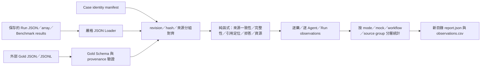

# Offline Evaluator MVP 使用與維護說明

版本 `offline-eval-0.1.0`，日期 2026-10-26。依據 `EVALUATION_DESIGN.md`，本次新增獨立離線模組，未變更既有 Benchmark、Agent、Prompt、RAG 或臨床決策流程。使用既有 Python／Pydantic，無新增依賴，不需要服務、LLM API、Ollama 或 GPU。

## 1. 已實作的資料流與範圍



| 檔案（相對 Repository root） | 職責 |
| --- | --- |
| `backend/app/evaluation/__init__.py` | Evaluator 版本 |
| `backend/app/evaluation/schemas.py` | Run envelope、manifest、Gold labels／未來 payload、Metric 契約 |
| `backend/app/evaluation/io.py` | JSON／JSONL、Run array／Benchmark results、原檔與內容 hash、重複 ID 檢查 |
| `backend/app/evaluation/alignment.py` | case_id、revision、snapshot hash、外部 source_case_group 對齊 |
| `backend/app/evaluation/metrics.py` | 純來源觀察、分類一致性、完整性、引用、abstention、token 函式 |
| `backend/app/evaluation/evaluator.py` | Run adapter、eligibility、逐單位結果與分層聚合 |
| `backend/app/evaluation/export.py` | 新目錄 JSON／CSV；拒絕覆寫 |
| `backend/app/evaluation/cli.py` | CLI、Schema 匯出、輸入錯誤與 exit code |
| `backend/tests/evaluation/test_offline_evaluator.py` | 明確標示的 synthetic engineering fixtures 與測試 |

模組不 import `app.main`、Repository、workflow、Agent、Provider 或 RAG。CLI 沒有 DB 連線功能；資料庫讀取只用於本次驗收前，以 SQLite `mode=ro` 抽出既存 Run 的 JSON 副本，未重新執行分析。

## 2. CLI：從專案根目錄開始

PowerShell：

```powershell
Push-Location backend
try {
    & ./.venv/Scripts/python.exe -m app.evaluation.cli `
      --runs ../data/runtime/evaluator-mvp-20261026/saved-run.json `
      --manifest ../data/runtime/evaluator-mvp-20261026/pilot-run-manifest.json `
      --out ../data/runtime/evaluator-mvp-my-next-run
} finally { Pop-Location }
```

`--out` 必須是全新目錄。輸入檔與 Gold 唯讀；不會改寫既有輸出。上例 manifest 已針對本次保存的 Run snapshot 計算 hash，不能直接套到不同匯出版本／病例。

多檔與 Gold：

```powershell
# 在 backend/ 執行；下列 paths 是使用者自己的輸入資產
./.venv/Scripts/python.exe -m app.evaluation.cli `
  --runs path/to/run-a.json path/to/run-b.json `
  --manifest path/to/manifest.json `
  --gold path/to/gold.jsonl path/to/more-gold.json `
  --out path/to/new-report

# 顯示正式資料契約，不建立 Gold
./.venv/Scripts/python.exe -m app.evaluation.cli --print-schema manifest
./.venv/Scripts/python.exe -m app.evaluation.cli --print-schema gold
```

Run 輸入支援單一物件、Run array、`{"results": [Run, ...]}`。Gold 支援單筆、array、`{"records": [...]}` 或每行一筆 JSONL。完全相同 Run ID／內容會去重並記 diagnostic；同 ID 不同內容拒絕載入。Gold record_id 重複也拒絕。JSON 重複 key、NaN／Infinity 均拒絕，不默默改值。

Exit code：`0`＝完成（允許 missing_gold／not_evaluated）；`1`＝報告已生成，但包含 alignment_error 或 invalid_output；`2`＝載入／Schema／IO 錯誤，包括既存輸出目錄。批次 envelope 不合法時整批拒絕，先修正或隔離壞檔，再重評；不默默丟掉該 Run。

## 3. 身份、政策與未評估狀態

### 3.1 Case identity manifest

正式版本為 `eval-manifest-0.1`，需要：

- `canonicalization="json-sorted-utf8-v1"`。
- `cases[]` 每筆含 `case_id, revision, case_snapshot_sha256, source_case_group, grouping_basis, grouping_sources, drug_universe`。
- `drug_universe` 不重複、不含空代碼，且涵蓋 snapshot 中所有來源藥物。可事前加入指引藥物；不能為改善分數而從 universe 刪掉來源藥物。
- 分組由外部研究協定提供。MVP 不由 case 名稱推測病人，不把同源五變體視為獨立樣本。`G01-provisional` 是保守 lineage/leakage group，不是患者 ID。

Hash 可用 `app.evaluation.io.content_hash(run["case_snapshot"])` 計算：UTF-8、object key 排序、compact separators、禁止 NaN；陣列順序、字串空白／換行保留。**不補 Case defaults、不轉日期、不統一數字型別**，因此它不等同原 handoff 整個 history 檔的 SHA-256。任何正規化差異需要明確重建資產／manifest，不靜默放寬比對。

無 manifest：仍可做工程觀察，但 `source_case_group=null`、identity_alignment 為 not_evaluated；Gold AST accuracy 不評。來源藥物 universe 的 pending 指標明確標為 `source_drugs_only`，不假裝涵蓋全部指引選項。

### 3.2 狀態不能互換

| 狀態 | 意義 |
| --- | --- |
| evaluated | 可計算；真正分類錯誤為此狀態下 value=0 |
| missing_gold | 尚無獨立、已審查、足以評分的標註 |
| not_evaluated | 無分母、不適用、未知 workflow、執行未完成、無結構化 prediction binding，或 scorer 尚未實作 |
| invalid_output | 完成結果缺藥列、重複／非法狀態、不合法引用／usage 結構等 |
| alignment_error | revision／snapshot hash／來源分組對不上；阻擋該 Run 的正常評分 |
| invalid_input | CLI 載入或 envelope 失敗，exit 2；不是模型判斷錯誤 |

`null` 保留；CSV 空欄配合 status/reason，不能讀成 0。執行失敗與格式壞列另外保留工程計數，不能當 pending。部分可評的 summary 同時呈現 `n_requested, n_evaluable, status_counts`，不把未評列藏起來。

### 3.3 AST 的三個不同問題

1. **ast_source_consistency**：來源忠實性的工程 proxy。獨立讀取 `CLSI_2022_pheno → clsi_2022_phenotype`、`source_report → source_phenotype`、`legacy → reported_sir`。只有來源無矛盾且 basis 已知才評；不使用 MIC 推論 breakpoint、不讀 Agent 的 source_validation 當答案。來源類別缺失時工程預期為 unknown；這不是臨床 Gold。
2. **ast_classification_accuracy**：需 manifest 對齊＋獨立 A_source Gold、`selected_source_classification` 標註已 adjudicated、有 accepted_labels、source_rows、policy 與 provenance 才評。無 Gold 時不借用前一項工程 proxy 充當 Gold。
3. **ast_conflict_detection_accuracy**：獨立任務。現行 Run 沒有對應 source-conflict 的結構化 Boolean prediction，因此即使有標註也回 not_evaluated，等待可審查的人工 binding／adapter；不以自由文字關鍵字或 Agent Audit verdict 推定成功。

`source_conflict_present` 只記錄輸入中的 selected-source 多類別、reported 多類別、selected/report 跨欄位矛盾，不代表 Agent 已偵測。

`agent-ast-conflict` 的 amoxicillin_clavulanate 選定來源仍為 S/S，reported 為 S/R。MVP 保留兩者；來源一致性回 `source_conflict_requires_independent_policy`，不覆寫為 R 或自行創造 conflicting Gold。混合 basis、同藥部分有類別部分缺失，也保守未評。日後若獨立 A Gold 裁決這個分類政策，Gold accuracy 與衝突偵測仍分開報。

## 4. 目前指標與計算邊界

| 指標 | 定義／限制 |
| --- | --- |
| agent_node_completeness | agent-led-1.6.0 六角色中恰有一筆紀錄的比例；缺／重複另有 invalid_output 診斷 |
| agent_output_completeness | Case 有 findings/issues/missing_fields list；其他角色依保存 input.drugs 檢查輸出逐藥列與合法狀態；failed/skipped 不當完成 |
| output_completeness | 逐藥集合須與 universe 一致、無重複及非法 final status；細節保留 valid/expected rows |
| ast_source_consistency | 無矛盾的來源類別與 AST normalized assessment 相等＝1；unknown 對已知類別＝0 |
| ast_classification_accuracy | 依獨立、合格的 A Gold accepted_labels 評分；本次真實病例未提供這類 Gold |
| citation_id_locatability | 輸出中 evidence_refs／quotes 的 chunk ID 可在保存 snapshots 定位的 occurrence 比例 |
| citation_location_availability | 上述引用有保存 location 的比例；不驗證原始 PDF 的實際頁面位置 |
| quote_exact_match | quote 是對應 snapshot.text 的非空原樣子字串比例；不改空白／換行，不判語意支持 |
| pending_rate／pending_indicator | 合法 pending／預先指定藥物數；缺／壞列不當 abstention，整體 rate 保守 invalid_output |
| agent_abstention_rate | AST/Clinical unknown、Evidence/Audit uncertain、Synthesis pending，各角色個別統計 |
| ai_candidate_count | 僅保存 output.candidates；physician_candidates 不算 AI 建議 |
| elapsed_ms | 保存的 Run／node 量測值；不補 queue、預計算、全程 wall-clock，也不把 Mock 耗時當 Live |
| input/output/total_tokens | 全部保存 attempts 的用量，含失敗／重試；不再加 run/node aggregate；缺漏只留 known_subtotal 與 coverage |
| estimated_cost | MVP 沒有價格快照與完整成本 scorer，保留 not_evaluated |

「完整性」是指定工程契約檢查，不是整份 production Schema 或醫療報告語意驗證。引用只檢查輸出，輸入檢索池不當作已引用；每個 role／published output 分開評，不能將重複保存的同一引用跨 target 加總作研究分母。空引用的分母為 0，結果為 null，並非滿分。引用可定位也不表示來源獨立、版本適用或內容支持聲明；完整 fact attribution 尚未實作。

Token 統計只有 `saved_attempts_only` 範圍。baseline 內部未保存的 retries 無法復原，缺 attempts 不會憑空讀 run usage 冒充完整總數。Mock token/cost 為 not_evaluated。未知 workflow／三種舊 baseline 保留能讀到的資源與輸出引用統計，六角色完整性／逐藥 pending 明確不適用；這一版不是四模式所有品質指標的完整 adapter。

以下已保留欄位／狀態，**尚未實作 scorer**：Retrieval P/R/CEMR、語意 Source Attribution、Claim P/R/F1、Unsupported Claim、Audit Detection、Clinical Risk、Candidate P/R、Unsafe Recommendation。沒有獨立 Gold 時為 missing_gold；已提供合格型別的標註時仍須等待 scorer，不會硬填 0。Clinical risk labels 必須宣告 independent_expert provenance 與 qualification_role；Schema 無法代替實際資格審核。

## 5. Gold 契約與標註流程

正式 `eval-gold-0.1` 與設計文件的 `eval-gold-0.1-proposed` 不同；草稿不會自動升格。

每筆 Gold：`schema_version, record_type, record_id, case_id, revision, case_snapshot_sha256, source_case_group, drug_code, labels, payload, synthetic_fixture`。

`labels` 以任務名為 key，例如 `selected_source_classification`、`source_conflict_detection`。每個 Label 包含：

```text
label 或 accepted_labels
review_status: draft | in_review | adjudicated | rejected
ground_truth_tier: A_source | B_document | C_clinical
policy_version
source_rows / conditions
annotation_provenance:
  source_assets
  annotation_guideline_version
  annotator_id / qualification_role / reviewer_ids
  origin: independent_source | independent_document | independent_expert | synthetic_fixture
```

adjudicated 需 policy、annotator、reviewer 與非缺席標籤。禁止用 mock／model_audit 作 origin。這是資料契約約束，無法自動證明人類填寫的 provenance 真實；研究流程仍須審查原始證據。MVP 尚不實作跨 reviewer 的 adjudication 工作流，已裁決資料由外部準備。

| record_type | payload 接口 |
| --- | --- |
| case_drug | labels 保留 selected-source classification 與 conflict detection；source_rows 含 index/field/raw value |
| retrieval_query | query_id/text/stage/dimension、corpus hash、requested_k、complete/pooled/top_k scope、judgments、critical AND/OR bundles |
| evidence_span | artifact/version/parser、原文單元 hash、Unicode code point [start,end)、quote hash、locator、source family |
| proposition_inventory | atomic proposition、statement、dimension、required、support label、evidence bundles、fact sources |
| run_claim | 同上，另需 Run content hash、node_id、claim_index；固定本次輸出 binding |
| audit_item | Run／claim／evidence-pack hash、錯誤類型、獨立 error label、預期偵測類別 |
| clinical_risk | risk dimension/label、必要資訊、條件、evidence spans |
| final_decision | acceptable_option/unacceptable_unsafe/not_indicated/insufficient_information、條件與 decision bundles |

`--print-schema gold` 同時列 `x-payload-schemas-by-record-type`；Loader 會依 record_type 強制驗證對應 payload，不接受未知欄位與非法 enum。空 judgments 仍不是「已確認沒有相關文件」，主指標不因此給零分。

所有測試數值只在 `backend/tests/evaluation/` 的 synthetic fixtures 中。載入 `synthetic_fixture=true` Gold 必須顯式 `--allow-synthetic-fixtures`，報告 provenance 會保留此模式；不得拿該模式產物作研究 Gold。本次實例沒有使用這個開關、沒有建立任何臨床答案。

## 6. Report 格式與重現性

- `report.json`：版本、輸入原檔 hash、Run content hash、manifest/Gold hash、argv、diagnostics、summary、完整 observations。
- `observations.csv`：與 JSON observations 同序、同欄位。每列含 run/case/revision/group、mode/mock/workflow、drug/agent、target、metric/version、status/reason、value、numerator/denominator、JSON 編碼 details。可依 agent/drug/target 篩選，不需 UI。
- summary 依 mode、is_mock、workflow、source_case_group、metric、target、agent 分層；Mock 不和 Live 平均。macro_mean 是該分層可評 observations 的描述平均，micro_value 僅合併合法非零 ratio 分母。**不是病例群體推論或信賴區間**；independent_sample_count 保留 null。
- 相同輸入／版本得到相同 observations/summary；原檔路徑與 CLI argv 是 provenance，所以搬移路徑後不要求整個 report bytes 相同。不可用 hash 比對誤把不同文字的 quotes 視為相同。
- private Gold 可存既有 ignored `data/local/evaluation/`；本機驗收輸出在 ignored `data/runtime/evaluator-mvp-20261026/`。轉交研究助理時須連同輸入、manifest、版本與測試證據另行保存。

## 7. 本次保存 Run 的實際結果

輸入：`51905060-412e-4e04-99f3-c9a1bbbbc596`，agent-complete revision 4，agent-led-1.6.0，Mock。`saved-run.json` 是 DB 內已保存 run_json 的唯讀副本。manifest 用該 snapshot 的精確 hash，source_case_group=`G01-provisional`，18 個來源藥物。沒有傳入 Gold。

| 觀察 | 結果 | 解讀 |
| --- | --- | --- |
| 六角色節點 | 6/6 | 紀錄存在，不是六個 Agent 都具有正確臨床推論 |
| 每個角色的工程輸出完整性 | 6 個角色皆 1.0 | Schema 所需主要 list／drug/status 完整；needs_confirmation 可有完整合法輸出 |
| 最終逐藥列 | 18/18 | 保留全部來源藥物 |
| Pending | 18/18＝100% | Mock 固定暫緩 |
| 五個有逐藥狀態的角色 abstention | 各 18/18 | AST／Clinical unknown、Evidence／Audit uncertain、Synthesis pending |
| AI candidates | 0 | 人工工作清單不算推薦 |
| AST 來源類別一致性 | 1/18＝5.56% | Mock 全回 unknown；僅 ertapenem 選定來源本來缺失而相符。不是醫療模型 accuracy |
| AST Gold accuracy／衝突偵測 | missing_gold | 沒有拿 Mock 或 validator 當答案 |
| 引用／quote | null，zero_denominator | 無輸出引用可核對，不是 100% 正確 |
| 保存 Run.elapsed_ms | 255.518 ms | 第一次 Mock 執行耗時，不是本次 evaluator 耗時或 Live 耗時 |
| token／cost | not_evaluated | Mock 沒有真實模型用量 |
| 臨床／語意／檢索品質 | missing_gold | 沒有獨立標註，不提供假分數 |

## 8. 測試、保全與下一步

Evaluation unit tests（從 backend 執行，使用全新 basetemp）：

```powershell
./.venv/Scripts/python.exe -m pytest tests/evaluation -q --tb=short `
  --basetemp ../data/runtime/evaluator-mvp-new-test/pytest
```

已驗證正常載入、必要欄位／Schema 錯誤、重複 ID、revision/hash/group mismatch、來源 S/S 與 reported S/R、missing/draft Gold、0 分母、錯／未核對引用、非法／缺藥輸出、六節點、失敗節點、缺漏 tokens、多 Run mock/live 分層、JSON/CSV 一致、唯讀輸入、拒絕覆寫、無 workflow/provider imports、禁止 network connect 下 CLI 可完成。其餘本次測試結果與保全證據見同目錄下的 `OFFLINE_EVALUATOR_VALIDATION.md`。

下一步建 Pilot Gold Dataset 的順序：

1. 凍結五病例 revision、snapshot hash、G01 同源身份及 drug universe。建立 A_source 的來源逐列記錄，獨立裁決 selected category 與 conflict detection 各自任務；不先改 Agent。
2. 由合格讀者建立版本化 corpus/query、relevance、critical spans；先明確 pool 是否完整，再實作 Retrieval scorer 的可手算 fixtures。不能只標當前系統命中的文件就宣稱完整 Recall。
3. 建立可追溯的 atomic claim inventory／Run binding，補 Audit 正反例；語意 binding 需人工審查，不能以字串 contains 替代。
4. 由適當專家完成 clinical risk／decision／unsafe 標註及分歧裁決後，再啟用相應 scorer。五個同源變體限於 dev pilot；推論泛化效果需另補獨立 held-out groups。

工程測試通過證明離線契約與運算可用，並不表示已驗證臨床推論正確性。這一版的研究價值在可追溯輸入、明確分母與誠實的未評估狀態。
