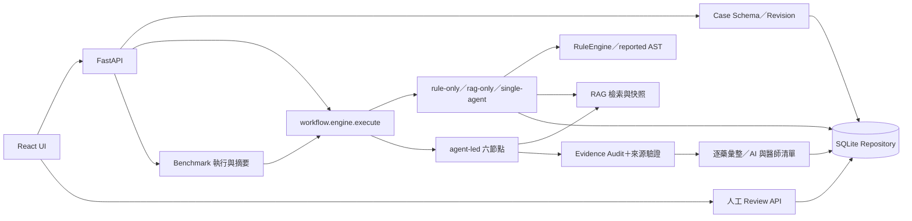

# Technical Handover：維護與研究 Baseline

文件日期：2026-10-26（Asia/Taipei）。適用程式版本：`1ad2648a349c28989c9fa3d41cd37bf56a40f0fd`。本文件記錄接手時的狀態，不代表後續修改後仍然成立。

本次僅靜態分析、唯讀環境盤點與新增文件；沒有重新分析病例、執行測試套件、呼叫 Live API、安裝套件、重建索引或修改資料庫。閱讀順序：本文件 → `TESTING_AND_DEBUGGING.md` → `RESEARCH_ROADMAP.md`。

證據等級：**V**＝本機指令／保存資料核對；**H**＝這台電腦先前操作的保存驗證紀錄；**S**＝現行原始碼確認、未在本輪執行；**P**＝後續建議，尚未實作。文件中的來源路徑均相對 Repository root；點擊連結使用本機絕對路徑，換電腦時按連結文字的相對路徑尋找。行號固定於上述 commit。

## 1. Baseline 識別與環境

| 項目 | 交接狀態 | 證據 |
| --- | --- | --- |
| Repository | `https://github.com/royalbear37/multi_agent` | 接手的 Repository；本輪不存取遠端 |
| 工作目錄 | `C:\Users\呂宜學\Documents\ChatGPT\multi_agent` | V：Get-Location |
| Branch／HEAD | `main`／`1ad2648a349c28989c9fa3d41cd37bf56a40f0fd` | V：git branch、rev-parse |
| 文件建立前工作目錄 | `git status --short` 無輸出；tracked diff 為空 | V；ignored runtime 不會出現在這項檢查 |
| 本次交付變更 | 只新增本文件及另外兩份交接文件；不 commit | 完成時另以 git status/diff 核對 |
| Python | `3.12.14`，64-bit Windows | V：`backend/.venv/Scripts/python.exe` |
| Python SQLite | `3.53.1` | V：`sqlite3.sqlite_version` |
| Node.js／npm | `24.19.0`／`11.6.2`，專案本機工具 | V：各自版本指令 |
| 後端環境 | `backend/.venv`；lockfile 的 36 個套件版本全部相符 | V：importlib.metadata 與 lockfile 逐項比較；pip 額外為 `25.0.1` |
| 前端環境 | `frontend/node_modules`；既有安裝來自 npm ci | H；重要套件另以 package.json 實際核對（V） |
| backend/.env | 本機不存在 | V；目前靠啟動程序的環境變數 |
| Playwright 瀏覽器目錄 | `frontend/.playwright` 不存在 | V；不代表系統上完全沒有其他瀏覽器 |

重要後端版本：FastAPI `0.141.1`、Starlette `1.6.0`、Pydantic `2.13.5`、uvicorn `0.53.0`、httpx `0.28.1`、pypdf `5.9.0`、jsonschema `4.26.0`、pytest `8.4.2`、pytest-cov `6.3.0`。完整安裝依據為 [backend/requirements.lock.txt](</C:/Users/呂宜學/Documents/ChatGPT/multi_agent/backend/requirements.lock.txt:1>)；`requirements.txt` 是範圍需求，不能替代固定版本 Baseline。

重要前端版本（V）：React／React DOM `19.2.0`、TypeScript `5.9.3`、Vite `7.1.12`、Vitest `3.2.4`、Playwright Test `1.56.1`。指令及版本宣告見 [frontend/package.json](</C:/Users/呂宜學/Documents/ChatGPT/multi_agent/frontend/package.json:1>)。前端安裝鎖定使用 `frontend/package-lock.json`，不是根目錄的同名檔。

接手時 SHA-256（V；未修改檔案）：

| 檔案 | SHA-256 |
| --- | --- |
| backend/requirements.lock.txt | `21892574dc552f17f776b02d4b622cb53ce1a7de9457f2af62d8f3f3315859d5` |
| frontend/package-lock.json | `bd90f277b2c857925f22cc29fa2c0bb4e75cb78e55ed7f6d695d4dc289fc36f7` |
| data/handoff/manifest.json | `bbca0365cedf09c840626cef6055972df621b110d795483f53f62aab6f9d51d8` |

### 1.1 啟動、停止及設定邊界

目前已安裝環境的可重複入口（H：Windows PowerShell 啟停已驗證）：

```powershell
Set-Location 'C:\Users\呂宜學\Documents\ChatGPT\multi_agent'
powershell -NoProfile -ExecutionPolicy Bypass -File .\data\runtime\mock-check\Start-Services.ps1
# 停止這組背景程序；不刪資料庫
powershell -NoProfile -ExecutionPolicy Bypass -File .\data\runtime\mock-check\Stop-Services.ps1
```

前端 `http://127.0.0.1:5173/`；後端 `http://127.0.0.1:8000/api/health`；API 文件 `http://127.0.0.1:8000/docs`。本輪沒有重啟服務或重新探測 HTTP；H 的成功狀態是保存紀錄，不是服務永遠在線的承諾。

要在終端觀察日誌，先停止背景服務，再於兩個 PowerShell 視窗分別執行 `Start-Backend.ps1`、`Start-Frontend.ps1`（同一 runtime 目錄）。各視窗按 Ctrl+C 停止。背景停止腳本只管理 `services.json` 中 PID、建立時間與執行檔都吻合的程序；前景程序不由它管理。

`Environment.ps1` 在當次程序設定絕對 DB／catalog 路徑、research rules、`lexical`、`mock`，移除 fixture override，設定 UTF-8、暫存目錄及本機工具 PATH；不改永久 PATH。Node 在 `data/runtime/mock-check/tools/bin/node.exe`，npm 在 `tools/npm/package`，`tools/bin/npm.cmd` 是本機 shim。**這些都是 ignored 的本機資產，新的 clone 不會自動取得。**

官方入口也存在：`scripts/setup.ps1`、`scripts/handoff.ps1`、`backend/scripts/run.ps1`、`scripts/frontend.ps1`。其中 setup 會安裝並 import `app.main` 初始化 DB；handoff 會匯入資料。不要在既有研究 DB 上盲目重跑；先指定新的隔離路徑。原始依據：[setup](</C:/Users/呂宜學/Documents/ChatGPT/multi_agent/backend/scripts/setup.ps1:1>)、[handoff](</C:/Users/呂宜學/Documents/ChatGPT/multi_agent/scripts/handoff.ps1:1>)。新環境如何驗證與測試見 Testing Guide。

| 軸 | 本機 Baseline | 其他設定與切換方式（S；本次未切換） |
| --- | --- | --- |
| 回答模型 | `LLM_PROVIDER=mock`，分析請求 `provider_kind=mock` | `unconfigured` 不使用可用模型；`live` 需 `LLM_BASE_URL`、`LLM_MODEL`、`LLM_API_KEY`。每次 Run 的 request 才決定該次 provider，不只看設定頁 |
| 檢索 | `RAG_RETRIEVAL_MODE=lexical` | `embedding` 使用 `EMBEDDING_BASE_URL`（預設 `http://127.0.0.1:11434`）、`EMBEDDING_MODEL`（預設 `embeddinggemma`）、`EMBEDDING_TIMEOUT`（預設 30 秒） |
| 每角色模型 | Mock 固定識別名稱 | Live 可用 `LLM_V2_<AGENT_ID大寫>_MODEL` 覆寫，包括 `LLM_V2_EVIDENCE_AUDIT_MODEL`；否則共用 `LLM_MODEL` |
| 預算 | 未額外覆寫，採程式預設 | `LLM_V2_MAX_CALLS` 控制 agent-led 總 calls（程式界限 6–8）；`LLM_AGENT_LED_TIMEOUT_SECONDS` 預設 780；角色 output token 設定見 `.env.example` 與 Agent 定義 |

這兩個軸彼此獨立：Mock + Embedding 仍可能呼叫向量服務；只有 Mock + Lexical 是目前無模型服務的操作路徑。Embedding 出錯不會偷偷改用 lexical。設定由 DocumentService 建立時讀取，變更檢索方式需重新建立服務／重啟後端。不得用 `Start-Backend.ps1` 直接切 Live：它會重新套用 Mock。未來若明確授權 Live／Embedding，在另一程序中先載入隔離 Environment，再覆寫所需環境變數，最後直接執行 `python -m uvicorn app.main:app`；不要改這份 Mock Baseline。

`app.main` 的 dotenv 使用 `override=False`，既有程序環境優先；相對 DB 路徑以 backend 為基準。不要輸出或提交 API key。`external_model_allowed` 已是舊 metadata，不是現行 Live 授權閘門。依據：[設定載入](</C:/Users/呂宜學/Documents/ChatGPT/multi_agent/backend/app/main.py:17>)、[Provider 設定及來源檢查](</C:/Users/呂宜學/Documents/ChatGPT/multi_agent/backend/app/agents/runtime_v2.py:104>)、[RAG 初始化](</C:/Users/呂宜學/Documents/ChatGPT/multi_agent/backend/app/rag/service.py:162>)、[Live/Mock 分支](</C:/Users/呂宜學/Documents/ChatGPT/multi_agent/backend/app/agents/runtime_led.py:79>)。

### 1.2 儲存、來源與驗證紀錄

| 內容 | 現在位置／語意 | 等級 |
| --- | --- | --- |
| 來源交接病例與修訂 | `data/handoff/cases/`、`data/handoff/manifest.json` | S；原件本次未動 |
| 固定醫療文件 | manifest 指向 WHO PDF、`data/handoff/references/`、`data/public_references/dailymed/` 等 | S；XML／MD 版本與 hash 在資料包中 |
| 現用病例、Run、Review、Benchmark | `data/runtime/mock-check/prototype.db` | V：28 cases、95 revisions、1 run、1 review、0 benchmark_runs |
| 文件庫與索引 | `data/runtime/mock-check/documents/rag.sqlite3` | V：24 documents、2111 chunks、0 chunk_embeddings |
| 匯入文件原件副本 | `data/runtime/mock-check/documents/originals/` | S：DocumentService 管理 |
| 藥物／菌種字典 | `data/runtime/mock-check/catalog.json` | H：95 藥物、97 菌種；不是原始 cohort CSV |
| 本機驗證摘要 | `data/runtime/mock-check/validation.json`、`README.md` | H：2026-10-26 本機首次測試紀錄 |
| 實際 Run 匯出 | `data/runtime/mock-check/first-run.json` | V：與 DB Run 內容一致（匯出日期字串改用 +08:00） |
| 測試 Review | `test-review.json`；review_id=`032218e1-913e-4a5e-9a9a-1493246f040d` | H；理由含 `[MOCK TEST]`，不是臨床標註 |

預設 `data/runtime/prototype.db` 與 `data/local/microbiology/catalog.json` 在接手盤點時均不存在（V）。所有程式匯入、測試與初始化都應先核對路徑，避免意外建立預設 DB。`import app.main` 會建立 Repository 並執行 migration；唯讀檢視不應用它。

首次 Run：`51905060-412e-4e04-99f3-c9a1bbbbc596`，agent-complete revision 4、18 AST、6 Mock calls、74 次檢索、68 個去重證據片段、18 drug_assessments、0 AI candidates、18 physician_candidates、`partial / needs_confirmation`、`usage=null`。六個 Agent 都有執行紀錄，沒有 failed Agent；未確認節點也列入 completed_agents。Mock 耗時 255.518 ms 不能當 Live latency。

已實際完成（H）：交接檔案／hash／Schema／WHO 節錄來源驗證、lockfile 安裝與 pip check、前端 HTTP／後端 health、網頁選病例並分析、節點／RAG／逐藥畫面、測試審閱保存、停止重啟與同一 Run/Review 重讀。**尚未在這台電腦完成**：完整 backend pytest、Vitest、TypeScript/Vite production build、自動 Playwright、四模式 Benchmark、Live 模型及 Embedding 驗收。本次沒有補跑這些測試。

`docs/AGENT_LED_160_VALIDATION.md` 記錄原工作站曾有後端 396 passed／前端 68 passed 等結果；這是歷史自述，不能移植成目前 Windows 環境的通過數。舊 README／`WORKFLOW_AND_BENCHMARK.md`／runner information_scope 還有五角色或舊規則流程描述；現行路由與版本應以程式為準。

## 2. 維護用架構



### 2.1 Case Management

- **功能與契約**：Canonical JSON 經 `normalize_case()` → Pydantic `Case`；包含 demographics、encounter、renal、allergies、microbiology、ast_results、medications、provenance 等。嚴格拒絕未知欄位；時間要求 timezone；來源／模擬欄位保留。
- **核心**：[schemas/case.py:156](</C:/Users/呂宜學/Documents/ChatGPT/multi_agent/backend/app/schemas/case.py:156>) `Case`；[case_adapter.py:56](</C:/Users/呂宜學/Documents/ChatGPT/multi_agent/backend/app/adapters/case_adapter.py:56>) `normalize_case`；[main.py:186](</C:/Users/呂宜學/Documents/ChatGPT/multi_agent/backend/app/main.py:186>) 匯入與修訂 API；[sqlite.py:118](</C:/Users/呂宜學/Documents/ChatGPT/multi_agent/backend/app/repositories/sqlite.py:118>) `upsert_case`。
- **輸出／依賴**：CaseRecord=`case_id, revision, case, warnings` 等；新增版本保存至 case_revisions，Run 固定 case_snapshot/case_revision。依賴 Adapter、Schema、Repository，供所有工作流使用。
- **已有測試**：`test_backend_contract.py`（欄位、時區、alternate import、過敏修訂）、`test_handoff.py`（歷史保留、匯入衝突）、`test_reported_cohort.py`（hybrid provenance）。
- **修改影響**：Agent facts 投影、baseline summary、fact_refs 路徑、交接驗證、contracts JSON/OpenAPI、前端表單與版本比較；病例新版本不能改寫舊 Run。

### 2.2 AST Processing

- **功能**：來源 CSV 的 phenotype／raw measurement 正規化；reported baseline 依來源類別篩選；agent-led 由專責 Agent 分析後驗證來源連結。不是同一條 AST 演算法。
- **核心**：[microbiology.py:39](</C:/Users/呂宜學/Documents/ChatGPT/multi_agent/backend/app/adapters/microbiology.py:39>) `ast_row/build_case`；[reported.py:13](</C:/Users/呂宜學/Documents/ChatGPT/multi_agent/backend/app/rules/reported.py:13>) `evaluate_ast/evaluate_rules`；[rules/engine.py:149](</C:/Users/呂宜學/Documents/ChatGPT/multi_agent/backend/app/rules/engine.py:149>) `candidate_drugs`；[ast_sources.py:10](</C:/Users/呂宜學/Documents/ChatGPT/multi_agent/backend/app/workflow/ast_sources.py:10>) `validate_ast_sources`。
- **輸入／輸出**：`ASTResult[]` 有 reported_sir、source_phenotype、clsi_2022_phenotype、interpretation_basis、raw_measurement；Agent ASTItem 輸出 assessment、reason、category_source_refs，再加 category_sources/source_validation。來源 refs 以 `ast_results.<index>.<field>` 定位；index 必須保持原始順序。
- **已有測試**：`test_reported_cohort.py`（非 S 不轉 S、原始數值不補 MIC、初步／衝突報告）、`test_ast_sources.py`（錯藥引用、選定依據、缺類別）、`test_agent_led.py`（來源錯誤不往下傳成已確認結論）。
- **修改影響**：Synthesis、獨立 Audit、baseline allowlist、醫師排除清單及顯示。不得把 `unknown`／未測直接當 S；群體 resistance_context 不等於個人 AST，也不是院內 antibiogram。

### 2.3 RAG Retrieval

- **功能**：固定文件匯入／去重／版本與來源 lineage、PDF/MD/TXT 解析切段、FTS lexical 或 Ollama embedding、範圍／文件類型路由、相鄰片段與證據快照。
- **核心**：[rag/service.py:335](</C:/Users/呂宜學/Documents/ChatGPT/multi_agent/backend/app/rag/service.py:335>) `import_document`；`:424` `_parse`；`:483` `_text_chunks`；`:299` `search_agent_context`；`:878` `_embedding_search`；`:1010` `_lexical_search`；`:272` `snapshot`。
- **契約**：查詢帶 query、limit、policy_refs、scope，agent-led 再帶 stage/drug_code。結果有 status、evidence[]、warnings、retrieval_method；片段包含 chunk_id、doc_id、text、location、文件版本、population、document_kind、source_document_id 等。run.retrievals 保存 query/stage/drug_code/dimension/chunk_ids/primary_ids/status/count/method/elapsed_ms。
- **依賴**：文件來源、Pypdf、SQLite FTS、EmbeddingProvider；被 workflow 使用。`compact_sources()` 移除儲存用 metadata，不改原文。Agent 引用與歷史 Run 使用當次快照，不能用今天的索引替代歷史證據。
- **已有測試**：`test_rag.py`（向量維度、失敗保留、版本與 population、lineage）、`test_document_delete.py`、`test_reference_bundle.py`、`test_agent_retrieval_budget.py`、`test_source_scope.py`。
- **修改影響**：所有生成模式、citation refs、Audit context、Benchmark 可比性、前端來源顯示。重建索引、更新 population 或刪文件都是資料變更，應使用研究副本。

### 2.4 Multi-Agent Orchestration

- **現行入口**：[workflow/engine.py:382](</C:/Users/呂宜學/Documents/ChatGPT/multi_agent/backend/app/workflow/engine.py:382>) `execute` 對 multi-agent 直接轉 [agent_led.py:258](</C:/Users/呂宜學/Documents/ChatGPT/multi_agent/backend/app/workflow/agent_led.py:258>)，不是舊 `workflow/v2.py`。角色與 Prompt 定義：[runtime_led.py:68](</C:/Users/呂宜學/Documents/ChatGPT/multi_agent/backend/app/agents/runtime_led.py:68>)；版本 `agent-led-1.6.0`。
- **順序／契約**：case_agent → ast_agent → evidence_agent → clinical_agent → synthesis_agent → evidence_audit；另有不呼叫模型的 candidate_presentation/human_review。共用 Input 包含 facts、ast_results、drugs、evidence、assessments、claims、要求旗標及 evidence_groups；各角色輸出由 `contracts_led.py` 定義。
- **資訊流**：前四角色直接拿原始病例，並非前一角色依序改寫病例。AST 獨有 resistance_context；Evidence／Clinical 拿不同檢索池；Synthesis 拿前四角色報告，quotes 轉 refs，僅附已引用來源 metadata；Audit 拿聲明、精簡病例和被選原文，不拿前置支持判決。
- **執行控制**：有 checkpoint、每角色／總時間與 calls 預算、partial row 保留、最多一次修復機會並保留後續 calls。Live 經 wire schema／短來源別名／span selector 還原，Mock 直接產生固定 canonical 回覆，不覆蓋完整 Live wire 路徑。`time_budget.py`、`partial_agents.py`、`citation_spans.py`、`wire_validation.py` 都在依賴鏈。
- **已有測試**：`test_agent_led.py`、`test_agent_led_140.py`、`test_agent_time_budget.py`、`test_agent_output_budget.py`、`test_input_context.py`、`test_citation_spans.py`。有些名稱含 real/live 的測試實際 monkeypatch Provider，不能當真實服務驗收。
- **修改影響**：輸入 hash、Prompt hash、重試數、時間／token、前端節點、Audit 與所有研究比較。`runtime_v2.AgentProvider` 仍被現行 runtime 繼承，不能因檔名含 v2 就刪除；`contracts_v2/workflow.v2` 等歷史路徑與舊測試需分辨。

### 2.5 Evidence Audit

- **功能**：模型檢查 statement 是否被原始來源支持，再用程式檢查可定位性、AST 類別來源、fact_refs、藥物／主題／產品範圍及五維度 claim 完整性。
- **核心**：[agent_led.py:366](</C:/Users/呂宜學/Documents/ChatGPT/multi_agent/backend/app/workflow/agent_led.py:366>) Audit 輸入；[audit_sources.py:8](</C:/Users/呂宜學/Documents/ChatGPT/multi_agent/backend/app/workflow/audit_sources.py:8>) `validate_audit_sources`；[claim_checks.py:10](</C:/Users/呂宜學/Documents/ChatGPT/multi_agent/backend/app/workflow/claim_checks.py:10>) `validate_claim_checks`；[source_scope.py:53](</C:/Users/呂宜學/Documents/ChatGPT/multi_agent/backend/app/workflow/source_scope.py:53>) `source_scope_issues`；[audit_context.py:6](</C:/Users/呂宜學/Documents/ChatGPT/multi_agent/backend/app/workflow/audit_context.py:6>) `fit_audit_context`。
- **契約**：輸入每藥 claim/claims[]/risk_claims[]/fact_refs/evidence_refs；輸出 verdict、basis、fact_match、ast_check、risk_checks、claim_checks、quotes。程式再加 ast_check_validation、provenance_issues、claim_checks_complete。五維度：infection、ast、allergy、renal、interactions。
- **已有測試**：`test_audit_sources.py`、`test_source_scope.py`、`test_risk_dimensions.py`、`test_allergy_provenance.py`、`test_agent_led_140.py`。
- **修改影響／限制**：是必要來源檢查，不是完整語意／臨床驗證器；模型判斷仍需獨立 Ground Truth。Audit 不重新找遺漏證據；沒有被上游選取的來源就不會進來。context 裁切保留 claims/facts 並記錄省略來源；`claim_checks_complete=true` 只表示五維度齊全，不表示 supported。

### 2.6 Result Aggregation 與醫師決策

- **核心**：[agent_led.py:485](</C:/Users/呂宜學/Documents/ChatGPT/multi_agent/backend/app/workflow/agent_led.py:485>) 組合 Synthesis＋專家報告＋來源 AST；[claim_checks.py:71](</C:/Users/呂宜學/Documents/ChatGPT/multi_agent/backend/app/workflow/claim_checks.py:71>) `classify_options`；[physician_candidates.py:10](</C:/Users/呂宜學/Documents/ChatGPT/multi_agent/backend/app/workflow/physician_candidates.py:10>) `physician_selection`；[physician_review.py:10](</C:/Users/呂宜學/Documents/ChatGPT/multi_agent/backend/app/workflow/physician_review.py:10>) `validate_drug_decisions`。
- **契約**：drug_assessments 是逐藥完整報告；output.candidates 只收 status=reviewable，pending/avoid/review_options 分開；physician_candidates 是另套排除規則後的醫師工作清單，verification_status=complete/incomplete。Review 另存 drug_decisions、理由、條件與 system_assessment，不改 AI 原判斷；可記錄 outside_analysis 的醫師新增藥名。
- **已有測試**：`test_physician_candidates.py`、`test_physician_review.py`、`test_safety_regressions.py`；前端 `AgentLed.test.tsx`、`PhysicianReview.test.tsx`、`ReviewEditor.test.tsx`。
- **修改影響**：UI 數量、整份結果與逐藥審閱兩種 API 路徑、匯出、Benchmark 完成率。不能將醫師可選清單長度當 AI 正確率；本次 Mock 的 18 個醫師候選全為 incomplete，甚至來源 R 藥品也尚未由 Agent 確認排除。

### 2.7 Benchmark & Evaluation

- **核心**：[main.py:419](</C:/Users/呂宜學/Documents/ChatGPT/multi_agent/backend/app/main.py:419>) `_benchmark` 與 [benchmark.py:108](</C:/Users/呂宜學/Documents/ChatGPT/multi_agent/backend/app/workflow/benchmark.py:108>) `summarize`。輸入 case_ids、modes、provider_kind、request_id；輸出 benchmark_id/results/summary，保存 benchmark_runs/results 及各 Run。
- **既有測試**：`test_workflow.py::test_benchmark_reports_real_denominators_and_na_zero_denominator`、`test_acceptance.py::test_benchmark_records_all_modes_and_keeps_configuration`；UI `Insights.test.tsx`；瀏覽器 `workflow.spec.ts` 有四模式與單模式歷史情境，但部分其他 E2E 斷言已落後，不能宣稱全套可通過。
- **修改影響**：比較組別、分母與研究結論、前端報表。變更評分須獨立版本化，不可悄悄用新算法覆蓋舊 summary。

現有指標（S）：

| 類別 | 實作與解讀 |
| --- | --- |
| 完成／狀態 | completion=gate ready_for_review 且 output 非 null／全部 Run；failed、blocked、safety_withholding 等比例 |
| 缺漏與規則 | 有 eligible expectations 才算 missing precision/recall、expected block recall、unnecessary block rate；agent 模式不評規則 pass rate |
| 引用 | candidates/avoid 中 evidence_refs 是否存在當次 snapshots、是否有 location；不涵蓋 pending 的全部 claims，不測語意支持 |
| Schema／白名單 | 依 candidate_presentation.attempted/schema_valid 與錯誤名稱統計；不是每個 Agent 的原始 wire 合格率 |
| Retrieval | 查詢數、返回片段數（可重複）、failed/budget_exceeded 數、耗時；沒有 Recall@k、nDCG 或逐維度 relevance GT |
| Agent | 逐角色 executions、attempt calls、failed/skipped、已知 token、usage_complete、節點耗時、Audit verdict 計數 |
| 分組 | by_mode、by_execution（mock 與 live_or_none）、by_workflow_version；live_or_none 混合無模型與 Live，不能單看組名推論模型呼叫 |
| 未實作評估 | citation_support_conclusion、appropriateness、expert_agreement、clinical_utility 都明確 not_evaluated；零分母是 null，不是零分或滿分 |

精確定義見 [benchmark.py:29](</C:/Users/呂宜學/Documents/ChatGPT/multi_agent/backend/app/workflow/benchmark.py:29>) 與 [:87](</C:/Users/呂宜學/Documents/ChatGPT/multi_agent/backend/app/workflow/benchmark.py:87>)。`not_configured_ratio` 將 partial 與 not_configured 合併，因此會把本次「有完整 Mock 流程但 pending」也歸入，不能解釋成設定故障率。failed_queries 不包含所有可能的保留時間／無結果狀態。沒有正式費率成本計算、置信區間、配對檢定或完整逐維度錯誤評分。

### 2.8 Database & API

- **核心**：[repositories/sqlite.py:32](</C:/Users/呂宜學/Documents/ChatGPT/multi_agent/backend/app/repositories/sqlite.py:32>) `SQLiteRepository`，WAL、外鍵、RLock、內建 migration；`:164` save_run、`:175` get_run、`:185` add_review。`main.py` 定義 /api/cases、runs、documents、reviews、benchmarks；POST runs 是同步工作，不是背景 task queue。
- **資料形式**：cases/current_revision + case_revisions 歷史；runs.run_json 是完整保存結果，另拆 node_executions、rule_evaluations、evidence_snapshots。Review 與 Benchmark 是獨立 JSON 紀錄。DocumentService 有另一個 SQLite。
- **讀取邊界**：`_public_run` 會移除不應發布的 baseline 內容，並可在回傳時補算 physician 清單；GET/匯出不一定與內部 DB JSON 位元組相同。研究時記錄使用哪一層資料。新 Run 保留病例版本及來源快照；既有 Review 不因讀取而成為 Gold Label。
- **已有測試**：`test_backend_contract.py`、`test_acceptance.py`（idempotency、修訂隔離、重啟恢復、Review 重讀）、`test_document_delete.py`、`test_handoff.py`。
- **修改影響**：合約／前端 generated types、既有 DB migration、重啟 INTERRUPTED 處理、API quarantine 與所有研究資料。不要單獨複製使用中的 WAL 主 DB 當完整備份；維護備份應停止寫入或用 SQLite backup API，並同時保存文件庫、原件與 catalog。

## 3. 接手者必須保留的研究邊界

目前是可運作的研究原型與離線流程 Baseline，尚不是已驗證 Multi-Agent 效益的研究 Baseline。已有專責 Prompt、角色 Schema、不同資訊投影與獨立 Audit context；預設仍共用模型且串行執行，不能宣稱錯誤彼此統計獨立。四模式共用部分基礎設施，但資訊量、檢索策略、規則閘門、生成次數與驗證強度不同。具體比較設計與已確認限制見 `RESEARCH_ROADMAP.md`。

先讀五個入口：`backend/app/main.py`、`backend/app/workflow/agent_led.py`、`backend/app/agents/runtime_led.py`、`backend/app/rag/service.py`、`backend/app/workflow/benchmark.py`。修改前先依 Testing Guide 建立可重複的軟體測試紀錄，再建立獨立 Gold 評估；不要從增加候選數或增加 Agent 數開始。
